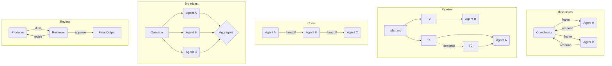
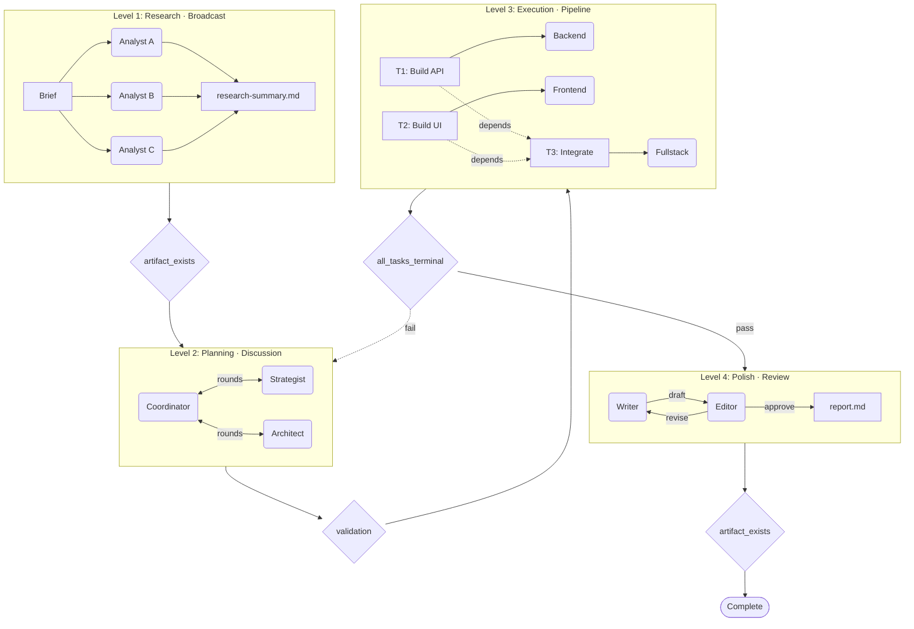
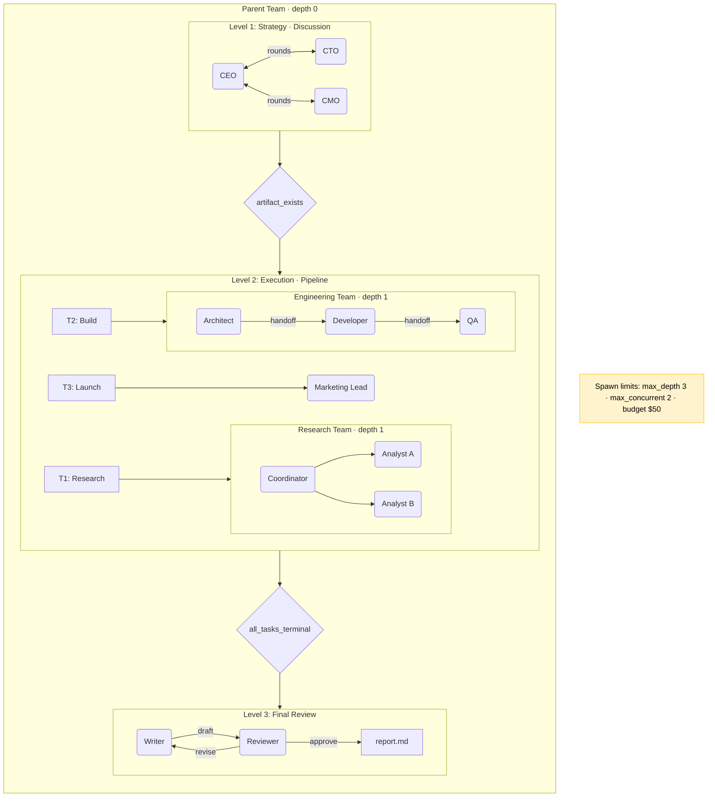
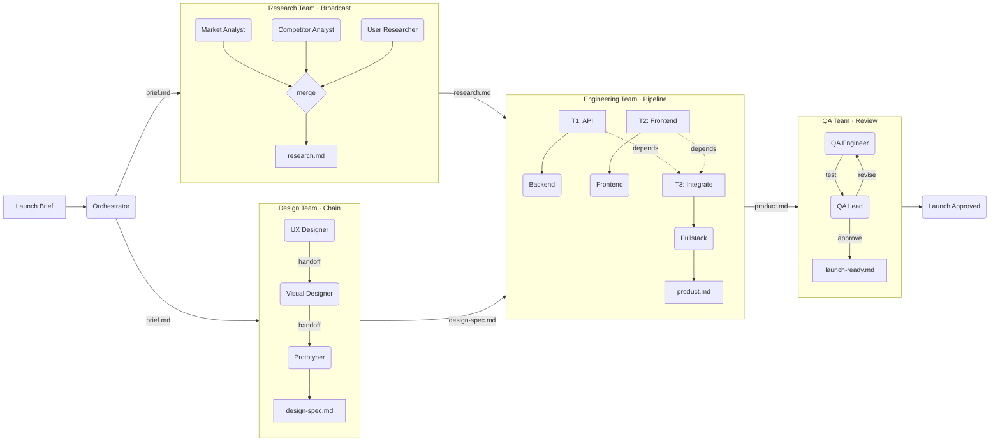

# Pipeline — Multi-Agent Workflow Runtime

Pipeline is a macOS desktop app and TypeScript runtime for building and running
contract-driven, multi-agent workflows. Define agents as Markdown prompts,
compose teams and workflows in YAML, and run them through the desktop UI or the
Pi CLI. No TypeScript is required to define a workflow.

A single team can chain multiple levels together — for example, a routing intake, then a broadcast research phase, then a moderated discussion, then a task pipeline, then a review loop — with gates controlling transitions between them. Teams can invoke other teams as sub-agents, enabling hierarchical composition where a parent team dispatches work to specialized child teams, each running their own internal workflow. Six stage types (`routing`, `discussion`, `pipeline`, `chain`, `broadcast`, `review`) can be mixed freely across levels.

## Launch

Use Node.js 22. Install the locked dependencies for the repository root, UI,
and file parser after a fresh clone or when creating a worktree:

```bash
npm run setup:worktree
```

### Electron desktop app

Build and launch the desktop application:

```bash
npm run desktop:start
```

For development with Vite hot reload:

```bash
npm run desktop:dev
```

Both development commands rebuild their Electron code before launch. If a
development instance from this same worktree is already running, the command
asks it to shut down gracefully and starts the newly built instance only after
the existing process releases ownership. This prevents a rebuilt renderer from
reopening an older desktop backend. `desktop:dev` then keeps the renderer on the
Vite hot-reload path.

Ordinary second launches that do not carry the development-replacement request
retain the normal single-instance behavior: they focus or recreate the existing
window without restarting its process. A development command never kills an
instance owned by another worktree or an older instance that cannot prove the
replacement protocol. Instead, it stops after a bounded wait with instructions
to quit the conflicting app manually and retry.

The desktop backend binds to a random port on `127.0.0.1` and uses a new
high-entropy URL token for every launch. The renderer is sandboxed, has no Node
integration, and sends external HTTP(S) links to the operating-system browser.

In a packaged build, editable project definitions live under Electron's
per-user data directory in `project/`; runs and sessions live in the sibling
`workspace/` directory. On first launch, the app seeds `agents/`, `skills/`,
`teams/`, `workflows/`, `start.yaml`, and `teams.yaml`. Later launches copy only
missing files and do not overwrite user edits. Development uses the repository
itself as the project root.

For controlled environments, override those locations before launch:

```bash
PIPELINE_DESKTOP_PROJECT_ROOT=/path/to/project \
PIPELINE_DESKTOP_WORKSPACE_PATH=/path/to/workspace \
npm run desktop:start
```

### Canvas Office previews

Canvas previews DOCX, XLSX and PPTX locally and supports reviewed edits to retained
working copies. Saved Markdown can generate a Word snapshot with source provenance.
See [the Canvas guide](docs/feature-canvas.md#preview-and-revise-office-files).

Development and packaging use an operator-staged OfficeCLI **1.0.157** executable.
There is no runtime installer or global executable fallback. Obtain the approved
macOS arm64 or x64 release and its matching source notices, then stage them:

```bash
npm run office-tools:stage -- approved-release/officecli approved-release/source
npm run office-tools:verify
```

The stage command refuses unpinned upstream SHA-256 values and copies the license
and third-party notices. Build inputs live under the ignored
`build/office-tools/darwin-<architecture>/` folder. Packaging signs the native tool
before bundling, then checks its final digest, version, strict signature, app-team
match and hardened runtime. When more than one signing identity is available,
set `OFFICE_TOOLS_SIGN_IDENTITY` to the app's Developer ID Application identity.
Signature validation does not prove notarization or clean-machine acceptance.

### Pi CLI

Since you're already in the project folder, just run:

```bash
pi -e team-runtime/index.ts
```

If running from another directory:

```bash
pi -e /path/to/Pipeline-template/team-runtime/index.ts
```

The runtime looks for `start.yaml` in the folder you run from. If it finds one,
it resolves the selected entry through `teams.yaml` and boots that team. If it
does not, setup mode activates automatically.

## Setup

When `start.yaml` does not exist in the working directory, the runtime enters **setup mode** — an interactive setup agent that guides you through creating your team configuration and agent prompts via conversation.

The setup agent will ask about your team's purpose, structure, stage types, agents, constraints, and gates, then generate all the files for you.

### Importing pre-prepared agents

If you already have agent folders prepared elsewhere, provide the path to the setup agent and it will automatically:

- Scan the source folder for agent subdirectories
- Copy each agent into the local `agents/` directory with the correct structure (`agents/<name>/<name>.md`, `experience/`, `skills/`)
- Copy skills locally from their original absolute paths into each agent's `skills/` folder
- Create experience scratch pads for each agent
- Generate or update the selected team's `team.yaml` with the imported agents (using the source folder's README for team metadata if available)
- Create `start.yaml` and `teams.yaml` so the imported team can boot through the registry

Just tell the setup agent something like "import agents from `~/my-agents/`" and it handles the rest.

After setup completes, restart the session so the runtime loads the new configuration.

## How It Works

The runtime looks for `start.yaml` **in the folder you run from**. `start.yaml`
selects a named entry from `teams.yaml`, and that entry resolves to the actual
team folder containing its executable `team.yaml`.

In this repo, the default start entry is now a **reception desk**: a single
`receptionist` agent handles intake and routes work to specialist teams such as
the `problem-thinking-board`.

When a level enables `permissions.spawn_teams: true`, the coordinator can use
the `spawn_team` tool to delegate to any registered specialist team in
`teams.yaml`.

When team spawning is enabled, registry-backed team entries are also surfaced in
the live runtime roster automatically. You can still add explicit `type: team`
entries in `team.yaml` when you want per-team overrides such as custom role
text, mounts, or artifact defaults.

```
your-team-folder/
  start.yaml             <-- Preferred launcher
  teams.yaml             <-- Preferred registry
  agents/                <-- Shared agent prompts
    agent-a/
      agent-a.md
      experience/
        scratch-pad.md
      skills/            <-- Optional (skill folders with SKILL.md)
  teams/
    reception-desk/
      team.yaml          <-- Executable config for the selected team
    another-team/
      team.yaml
  input-files/           <-- Optional (files here are injected as context to all agents)
  workspace/             <-- Created automatically
    assignments/
      2026-03-25-1430-team-name/
        brief.md         <-- Task formulation written by coordinator (YAML frontmatter + markdown body)
        report.md        <-- Final output (YAML frontmatter + markdown body)
        minutes.md       <-- Auto-generated meeting minutes (YAML frontmatter + markdown body)
        logs/
          conversation.jsonl
          tool-use.jsonl
```

Runtime-owned markdown artifacts now include a standard YAML frontmatter envelope.
This keeps the body readable for humans while giving the runtime stable metadata
for validation and handoffs. At minimum, runtime-owned artifacts include
`artifact_type`, `schema_version`, `created_at`, `filename`, and `path`.

## Try the Example

Run directly from the example folder:

```bash
cd examples/brainstorm-team
pi -e ../../team-runtime/index.ts
```

The example is a 3-agent brainstorming team:

- **facilitator** (coordinator) — guides the discussion, synthesizes ideas
- **creative** (participant) — generates ideas, makes connections
- **critic** (participant) — evaluates feasibility, identifies risks

Two levels: brainstorming discussion (3 rounds max) followed by a review loop (creative produces, critic reviews).

## Create Your Own Team

### Step 1: Copy `start.yaml` into your project root

```bash
cp /path/to/Pipeline-template/setup/templates/start.yaml ./start.yaml
```

Set its `entry:` to the team you want to launch by default.

### Step 2: Create `teams.yaml`

```bash
cat > teams.yaml
```

Add a registry entry that points to the selected team's folder.

### Step 3: Create the selected team's `team.yaml`

Put the executable config in `teams/<name>/team.yaml`, then define its agents,
levels, and gates there. See [Configuration Reference](#configuration-reference)
below.

### Step 4: Create agent folders and prompts

For each agent in `team.yaml`, create a matching folder with a prompt file. The `agent_file:` path in `team.yaml` is relative to `team.yaml` itself.

```bash
mkdir -p agents/my-agent/experience
cp /path/to/Pipeline-template/setup/templates/agent.md agents/my-agent/my-agent.md
cp /path/to/Pipeline-template/setup/templates/experience-scratch-pad.md agents/my-agent/experience/scratch-pad.md
```

Make sure the `agent_file:` entry in `team.yaml` points to this file:

```yaml
agents:
  - name: my-agent
    agent_file: agents/my-agent/my-agent.md   # <-- must match
```

### Step 5: Add skills (optional)

Skills are loaded from `skills/<name>/SKILL.md` directories inside each agent's folder. They're injected into the agent's prompt via `{{SKILLS_BLOCK}}`.

```bash
mkdir -p agents/my-agent/skills/my-skill
cp /path/to/Pipeline-template/setup/templates/skill.md agents/my-agent/skills/my-skill/SKILL.md
```

Edit the SKILL.md to define the skill's purpose, method, and expected output. See the brainstorm-team example for working skills.

### Step 6: Run

```bash
pi -e /path/to/Pipeline-template/team-runtime/index.ts
```

## Input Files

Drop files into an `input-files/` folder next to your `start.yaml`. The runtime reads them at boot and injects their content as context to all agents automatically. If the folder doesn't exist or is empty, nothing happens.

The content is available as `{{INPUT_FILES}}` in coordinator prompts.

### Binary files (PDFs, images, DOCX, XLSX, and PPTX)

The CLI runtime does **not** read binary files directly. Use the file-parser
toolkit to create Markdown under `input-files/parsed/`:

```bash
npm --prefix file-parser run parse -- ../input-files
```

The desktop Run workspace does this automatically after an upload. Packaged
builds execute the bundled, compiled parser and do not depend on a global
`tsx`/`npx` installation. Parser startup and non-zero exit failures are returned
to the UI instead of being silently ignored. The runtime prefers parsed or
enriched Markdown when it exists; re-run the CLI with `--force` to re-parse all
files.

See `file-parser/` for supported formats and options.

## Dashboard

The desktop UI has three workspaces:

- **Run** creates persistent sessions, collects chat/file context, selects a
  workflow through a reviewable run plan, and launches it.
- **Create** provides Workflow, Team, Agent, and goal-level Plan modes. Plan mode
  previews a runnable workflow plus any dependent team/agent work and requires
  explicit approval before files are written. The server persists the exact
  issued plan, rejects changed apply payloads, and waits for active mutations to
  stop before confirming cancellation.
- **Admin** inspects runs, timelines, diagnostics, and artifacts.

Session tasks persist their state under `workspace/sessions/`. The lifecycle is
`queued` -> `running` -> one of `done`, `failed`, `blocked`, or `cancelled`.
Terminal transitions are atomic and cannot be overwritten by a late runner
result. User cancellation records the terminal state before signalling an owned
detached process group when process-group metadata is available. After an API
restart, identity-verified live workers are reattached. A restarted API
terminates three kinds of worker before it recovers the task: a verified worker
whose task had not started running, a verified worker that uses an obsolete
provider broker identity, and an unverified process group whose recorded leader
is dead. A worker that has exited is reconciled to an honest terminal failure.
Any other live process whose identity cannot be verified is not signalled, so a
reused PID is not killed, and the API that launched a task never terminates such
a group, even when its leader has exited. The task keeps its state and slot
until that process exits. Cancelling such a task records the cancellation. If
the task's identity marker then matches exactly one live process elsewhere,
recovery moves the record to that worker, stops it once verified, and releases
the slot without signalling the unrelated process that holds the old PID.
Otherwise the slot is released only once the recorded process is gone.

### Batch processing

Open **Run → Schedule & Batches** to save a desktop Batch definition for a
folder, eligible workflow, optional Workspace Project, extension filter, and
rerun policy. The workflow supplies the execution instructions; Batch adds no
per-run prompt. **Run now** scans the flat folder, shows a
preflight confirmation for more than 10 selected files or more than 100 MiB,
and creates one ordinary session/task per selected file. An empty extension
filter includes every supported file in the folder.

Batch work uses the same global TaskQueue as interactive and scheduled work.
Across all active Batches, accepted work is capped at the configured task limit
plus one queued readiness item; parser preparation remains serialized. Each
folder is limited to 50 files, 100 MiB per source file, and 500 MiB total.

Generated sessions keep immutable Batch, execution, and item provenance in
their `session.json`. Verified final and secondary artifacts are copied into
`workspace/batch-results/`, with limits of 10 artifacts, 25 MiB per artifact,
and 100 MiB per item. Copied results have no automatic expiry: use **Clear
copied results** on a terminal execution to reclaim those copies without
removing journals, rerun history, sessions, or original run artifacts.

Folders inside the workspace or project root are allowed directly. Other
folders require the sandboxed desktop picker grant and can be revoked under
**Settings → Batch folders**. The Batch form is desktop-only; trusted REST
clients may use paths allowed by the same server policy.

### CLI status widget

The runtime displays a live status widget while running:

- **Header** — team name, current level/round, total cost
- **Progress bars** — time elapsed and budget spent vs configured limits
- **Agent cards** — one per agent showing state (idle/active/done/error), round count, and cost. Cards blink when an agent is actively running.

The status bar shows: `team-name | level-name | N active | $X.XX`

## Stage Types

Each level has a stage type that determines how agents interact:

| Type           | Tool                | Pattern                                          |
|----------------|---------------------|-------------------------------------------------|
| **Routing**    | `spawn_team`        | Coordinator-only intake triage and delegation    |
| **Discussion** | `converse`          | Agents exchange positions in moderated rounds    |
| **Pipeline**   | `dispatch`          | Tasks with dependencies, serial/parallel execution |
| **Chain**      | `handoff`           | Sequential handoff A->B->C                       |
| **Broadcast**  | `broadcast`         | Fan-out same question, collect + aggregate       |
| **Review**     | `submit_for_review` | Produce -> review -> revise loop                 |

A team can mix stage types across levels. Level 1 might be a routing intake, level 2 a pipeline, level 3 a review.



### Discussion modes

The discussion engine supports 4 modes via `config.mode`:

- **brainstorm** — generate ideas freely, build on each other, avoid criticism
- **evaluate** — score and rank options, be rigorous and data-driven
- **debate** — take clear positions, argue with evidence, challenge opponents
- **deliberate** — weigh all perspectives, seek consensus, note dissent

### Pipeline plan format

The pipeline engine reads a `plan.md` file with this structure:

```markdown
# Plan: My Plan Title
**Status:** draft

### S1: Sprint Name
#### T1: Task title
- **Agent:** agent-name
- **Status:** pending
- **Validate:** false
- **Depends on:** none
- **Result file:** output.md
```

Task statuses: `pending`, `in_progress`, `completed`, `validated`, `failed`, `blocked`. Use `dispatch` with `task_id: 'auto'` to let the engine pick the next ready task, or specify a task ID directly.

### Broadcast aggregation

The broadcast engine supports 3 aggregation modes via `config.aggregation`:

- **merge** — concatenate all responses with headers
- **vote** — extract decisions from each agent, summarize votes
- **best** — present all responses and let the coordinator choose

## Gates

Transition conditions between levels. A gate must pass before the next level activates. Gates check for artifacts in the current assignment folder (`workspace/assignments/<session>/`).

The diagram below shows a single team with 4 levels, each using a different stage type. Diamond nodes are gates — the condition that must pass before the next level starts. Notice the loopback: if the Level 3 gate fails, the team re-enters Level 2 (Planning) instead of advancing. The final gate (`done`) ensures a report exists before the assignment closes.



### Gate types

| Gate type           | Behavior                                          |
|---------------------|--------------------------------------------------|
| `artifact_exists`   | Check if a file exists in the assignment folder   |
| `validation`        | Run a validator agent, check PASS/FAIL verdict    |
| `all_tasks_terminal` | All pipeline tasks in terminal state             |
| `manual`            | Only passes when triggered via `/team-advance`    |

### Between levels

Gates between levels use `from` and `to` to define the transition:

```yaml
gates:
  - from: deliberation
    to: refine
    condition:
      type: artifact_exists
      artifact: deliberation-summary.md
```

### Loopback gates

Gates can point backward to re-enter a previous level. Set the `to` field to an earlier level ID. The runtime tracks loopback count and stops after 3 iterations to prevent infinite loops:

```yaml
gates:
  - from: execute
    to: plan        # re-enter planning if execution fails
    condition:
      type: validation
      validator: quality-checker
      strictness: hard
```

### Completion gate (after the last level)

To enforce that a final artifact is produced before the assignment is considered done, add a gate with `to: done`. This checks the condition on the last level without advancing anywhere:

```yaml
gates:
  - from: deliberation
    to: refine
    condition:
      type: artifact_exists
      artifact: deliberation-summary.md

  - from: refine
    to: done
    condition:
      type: artifact_exists
      artifact: report.md
```

This ensures `report.md` must exist in the assignment folder before the session is marked complete. The coordinator will keep receiving constraint status messages telling it to write the report until the gate passes.

## Commands

| Command         | Description                                    |
|-----------------|-----------------------------------------------|
| `/team-status`  | Show current level, constraints, agent states  |
| `/team-advance` | Manually advance to next level (bypass gate)   |
| `/team-reset`   | Reset team to the first level                  |

## Testing

Use these commands from the repo root.

### Required local checks

```bash
npm test
node scripts/audit-security.mjs
```

`npm test` runs core unit/integration tests, the UI lint/test/typecheck/build
gate, and file-parser tests. The security audit covers all three lockfiles and
fails on unaccepted high or critical advisories. See `SECURITY.md` for the one
currently pinned upstream exception.

For a narrower development loop:

```bash
npm run test:unit
npm run test:integration
npm run ui:check
npm run file-parser:test
```

### Desktop checks

```bash
npm run desktop:e2e
npm run desktop:e2e:packaged
```

The first command builds the Electron main process, UI, and compiled file
parser, then runs the desktop smoke test. The packaged check creates an unpacked
macOS application and launches that application through Playwright. Both verify
the tokenized API, sandbox/CSP, compiled parser upload, and deterministic task
worker; the packaged check additionally verifies seeded writable project data.
Neither proves code signing or notarization.

### Existing smoke and fixture E2E checks

```bash
npm run test:smoke
npm run test:e2e
npm run test:e2e:reception-to-writing
npm run test:e2e:openrouter
```

- `test:smoke` verifies the minimal pipeline boot path through real Pi
- `test:e2e` runs the older pipeline-assignment end-to-end fixture
- `test:e2e:reception-to-writing` verifies receptionist-to-writing delegation with the deterministic fixture
- `test:e2e:openrouter` runs the same receptionist-to-writing fixture through the OpenRouter-backed setup

### Live receptionist and workflow E2E checks

These run against the real repo entrypoint and copied live config, using isolated temp workspaces.

```bash
npm run test:e2e:reception-startup
npm run test:e2e:routing-selection
npm run test:e2e:workflow-routing
npm run test:e2e:workflow-handoff
npm run test:e2e:anthropic-board
npm run test:e2e:provider-validation
npm run test:e2e:host-mismatch
npm run test:e2e:child-failure
npm run test:e2e:retry-guard
npm run test:e2e:review-override
```

- `test:e2e:reception-startup` verifies the real receptionist boot path, host-model selection, and intake prompt
- `test:e2e:routing-selection` verifies the receptionist routes a writing request to `writing-team` and an analysis request to `problem-thinking-board`
- `test:e2e:workflow-routing` verifies the receptionist selects `discussion-to-writing`, both downstream teams run, and a final draft is produced
- `test:e2e:workflow-handoff` verifies the workflow hands the discussion artifact body into `writing-team/incoming-brief.md` and keeps assignments out of `teams/*/workspace`
- `test:e2e:anthropic-board` verifies a reduced two-agent `problem-thinking-board` run executes through the real Anthropic provider and produces `output/decomposition-plan.md`
- `test:e2e:provider-validation` verifies missing agent-provider auth is reported as an explicit config error at startup
- `test:e2e:host-mismatch` verifies unsupported repo-local host providers are blocked with an explicit startup error
- `test:e2e:child-failure` verifies a failed delegated child team surfaces a failed parent delegation result with the child failure reason
- `test:e2e:autostart-recovery` verifies a delegated child whose stage autostart declines records the skip, hands the stage to its coordinator instead of replying NOOP, and still produces `output/decomposition-plan.md`
- `test:e2e:retry-guard` verifies the live routing path does not continue after an invalid routing tool call; in current live behavior the host halts before a same-turn retry
- `test:e2e:review-override` verifies workflow runtime overrides clamp the writing-team review loop to one iteration and still finalize through approve-with-warnings

### Full automated live suite

Run the full live coverage set one by one:

```bash
npm run test:e2e:workflow-routing && \
npm run test:e2e:workflow-handoff && \
npm run test:e2e:provider-validation && \
npm run test:e2e:host-mismatch && \
npm run test:e2e:child-failure && \
npm run test:e2e:retry-guard && \
npm run test:e2e:review-override
```

### Notes

- The live E2E scripts copy the repo into temp directories and do not mutate your working tree config at runtime
- Startup validation tests rely on the repo `.env` loader unless the script intentionally blanks a provider key for the scenario under test
- The live tests are slower than unit and integration tests because they exercise the real Pi launch path and real provider wiring

## Packaging and Release

Create an unpacked local macOS application:

```bash
npm run desktop:package
```

This writes the app under `release/`. The package contains the compiled desktop
task runner, compiled file parser and its runtime dependencies, UI bundle, and
curated built-in project definitions. Development-only parser packages are pruned before
signing, and macOS builds use the branded Pipeline icon. The build configuration
declares DMG and ZIP targets with hardened runtime enabled; producing
distributable artifacts still requires the release operator to supply Apple
signing and notarization credentials and to verify the resulting artifacts on a
clean machine.

The staged YouTube tools must match their pinned checksums and reported versions.
The standalone yt-dlp executable unpacks its Python runtime on startup, so staging
and version verification allow 60 seconds for that probe. FFmpeg and ffprobe
version probes retain their 10-second limit. A timeout still fails packaging.

For a local ad-hoc signed build without an Apple certificate, use an explicit
identity for both the tools and the app:

```bash
npm run desktop:build
npm run builtins:stage
YOUTUBE_TOOLS_SIGN_IDENTITY=- npm run youtube-tools:sign
npm run youtube-tools:verify
CSC_IDENTITY_AUTO_DISCOVERY=false npx electron-builder --dir --config.mac.identity=-
npm run youtube-tools:verify-packaged
```

Disabling identity discovery alone skips app signing and can leave Electron's
original signature invalid after repackaging. Ad-hoc signing does not establish
notarization or release distribution readiness.

Before a release, run `npm test`, `node scripts/audit-security.mjs`,
`npm run desktop:e2e:packaged`, and a live provider-backed workflow appropriate
to the changed provider/configuration. CI repeats core, UI, file-parser,
security, and packaged macOS desktop smoke gates on pushes and pull requests.

## Configuration Reference

### team.yaml

```yaml
team:
  name: my-team
  description: What this team does
  version: '0.1.0'

workspace:
  path: workspace
  watch: false

defaults:
  provider: codex

models:
  orchestration:
    model: default
    thinking: high
  strategic:
    model: default
    thinking: medium
  execution:
    model: default
    thinking: low

agents:
  - name: coordinator
    type: agent
    role: Orchestrates the workflow
    tier: orchestration
    agent_file: agents/coordinator/coordinator.md
    # experience_enabled: false   # Optional. Defaults to true.
    color: 178

levels:
  - id: discuss
    name: Discussion
    order: 0
    stage:
      type: discussion
      coordinator: coordinator
      participants:
        - agent-a
        - agent-b
      config:
        mode: brainstorm    # brainstorm | evaluate | debate | deliberate
        min_rounds: 1
        max_rounds: 3
        # Context window management (optional — omit for default 'full' behaviour)
        # context_strategy: full           # full (default) | recent_N | rolling_summary
        # context_window_rounds: 2         # recent_N only: keep last N rounds verbatim
        # summarize_after_rounds: 3        # rolling_summary only: compress after N rounds
        constraints:
          max_time_minutes: 10
          max_budget_usd: 10
        output:
          format: output.md

gates:
  - from: discuss
    to: done
    condition:
      type: artifact_exists
      artifact: report.md
```

Supported agent providers: `anthropic`, `openai`, `xai`, `deepseek`, `kimi`, `openrouter`, `pi`, `codex`, `gemini`, `lm-studio`.

### Session budget and provider pricing

Runs use a finite `$25` warning limit by default. Configure an enforced
dispatch limit at team level:

```yaml
budget:
  cap_usd: 30
  enforce: true
  on_exceed: halt       # halt | warn
```

API providers use a reported USD cost where available. Otherwise configure
both token rates on the agent:

```yaml
provider_config:
  input_cost_per_million_usd: 2
  output_cost_per_million_usd: 8
```

An enforced `halt` budget fails closed when a metered HTTP provider has no USD
price. It stops immediately after a completed dispatch reaches or crosses the
limit and refuses subsequent dispatches. Because providers report final usage
after completing a request, the last paid request can cross the configured
amount; this is a dispatch boundary, not a prepaid provider spending limit.
Subscription/local providers are explicitly treated as zero marginal cost. See
`docs/feature-b4-budget-accounting.md` for cap precedence, environment pricing,
reservations, and child-team propagation.

### Rate limiting

Throttle concurrent agent subprocess spawns across broadcast stages:

```yaml
rate_limiting:
  max_concurrent: 2      # maximum simultaneous agent subprocesses (default: 3)
  delay_between_ms: 500  # fixed delay after semaphore acquire, ms (default: 500)
```

See `docs/feature-rate-limiting.md` for engine-by-engine details and tuning guidance.

### Agent failure recovery

Configure per-agent failure policies and per-stage overrides. If not specified, the runtime uses
stage-type defaults: critical stages (pipeline/chain/review) retry twice then halt; additive stages
(discussion/broadcast) skip the failing agent and continue. Routing stages are coordinator-only, so
there is no participant-agent failure policy to apply inside the stage itself.

```yaml
agents:
  - name: creative
    type: agent
    tier: strategic
    agent_file: agents/creative/creative.md
    on_failure:
      policy: retry          # retry | fallback | skip | halt
      max_retries: 2         # default 2 when policy is retry (max 5)

  - name: critic
    type: agent
    tier: strategic
    agent_file: agents/critic/critic.md
    on_failure:
      policy: retry
      max_retries: 1
      fallback_agent: creative   # dispatched when retries are exhausted

levels:
  - id: brainstorm
    stage:
      type: discussion
      on_agent_failure: skip     # per-stage override: skip any failing agent in this stage
      coordinator: facilitator
      participants:
        - creative
        - critic
      config:
        mode: brainstorm

  - id: refine
    stage:
      type: review               # no on_agent_failure — uses default: retry(2)→halt
      producer: creative
      reviewer: critic
```

Structured error events are logged to `workspace/agent-errors.jsonl` (not merged into agent content).
The dashboard shows a `✗N` indicator on agent cards when failures occurred.

### Stage configs by type

**Routing:**

```yaml
stage:
  type: routing
  coordinator: receptionist
  config:
    constraints:
      max_time_minutes: 10
      max_budget_usd: 10
    output:
      format: routing-decision.md
```

Routing stages are coordinator-only. They do not use `participants`, `mode`,
or discussion-round controls. The coordinator asks only the minimum clarifying
questions needed to choose the right specialist team, then delegates with
`spawn_team`.

**Pipeline:**

```yaml
stage:
  type: pipeline
  coordinator: coordinator-name    # optional
  participants:
    - agent-a
  config:
    plan_file: plan.md             # relative to workspace, default: .pi-tasks/plan.md
    parallel: true
    constraints:
      max_time_minutes: 15
      max_budget_usd: 20
    gate:
      type: all_tasks_terminal     # or validation, artifact_exists
      strictness: hard             # hard | soft | off
```

**Chain:**

```yaml
stage:
  type: chain
  sequence:
    - writer
    - editor
    - reviewer
  config:
    handoff_format: markdown
    constraints:
      max_time_minutes: 10
      max_budget_usd: 10
    output:
      format: final-output.md
```

**Broadcast:**

```yaml
stage:
  type: broadcast
  fan_out:
    - analyst-a
    - analyst-b
    - analyst-c
  config:
    aggregation: merge             # merge | vote | best
    constraints:
      max_time_minutes: 5
      max_budget_usd: 10
    output:
      format: analysis.md
```

**Review:**

```yaml
stage:
  type: review
  producer: writer
  reviewer: editor
  config:
    max_iterations: 3
    on_max_iterations: approve_latest_with_warnings  # block | approve_latest | approve_latest_with_warnings | escalate_to_user
    constraints:
      max_time_minutes: 10
      max_budget_usd: 10
    output:
      format: reviewed-output.md
```

### Agent prompt variables

The runtime replaces these placeholders in coordinator prompts at boot:

| Variable             | Value                                          |
|----------------------|-----------------------------------------------|
| `{{SESSION_ID}}`     | Current session identifier                     |
| `{{TEAM_NAME}}`      | Team name from config                          |
| `{{CURRENT_LEVEL}}`  | Current level id                               |
| `{{PARTICIPANTS}}`   | Comma-separated agent names at this level      |
| `{{WORKSPACE_PATH}}` | Absolute path to workspace directory           |
| `{{ASSIGNMENT_PATH}}`| Absolute path to current assignment directory  |
| `{{CONSTRAINTS}}`    | Formatted constraint summary                   |
| `{{EXPERIENCE_BLOCK}}`| Content of the agent's experience files         |
| `{{SKILLS_BLOCK}}`   | Content of the agent's loaded skills           |
| `{{INPUT_FILES}}`    | Content of files in the input-files directory  |

Legacy aliases also work: `{{AVAILABLE_AGENTS}}`, `{{BOARD_MEMBERS}}`, `{{OUTPUT_PATH}}`, `{{OUTPUT_MODE}}`, `{{TASK_CONTENT}}`, `{{EXPERIENCE_PATH}}`, `{{DISCUSSION_PATH}}`, `{{MEMO_PATH}}`, `{{CONTEXT_FILES}}`.

### Agent experience policy

Experience collection is controlled per agent in `team.yaml`:

```yaml
agents:
  - name: writer
    type: agent
    role: Produces final copy
    tier: execution
    agent_file: agents/writer/writer.md
    experience_enabled: false
```

- `experience_enabled` defaults to `true` when omitted.
- When set to `false`, the runtime does not load the agent's `experience/`
  content into prompts, does not inject a usable `{{EXPERIENCE_PATH}}`, and
  skips the post-level experience reflection writeback for that agent.
- This is the recommended setting for pure executor roles such as writers,
  generators, and delegation-only team slots.

## Team-of-Teams

Teams can invoke other teams as if they were agents. The runtime supports two
patterns:

- register callable teams in `teams.yaml` and let spawn-enabled levels surface
  them automatically in the live roster
- add an explicit `type: team` entry in `team.yaml` when you want local
  overrides on the child-team slot

Example explicit roster entry:

```yaml
agents:
  - name: research-team
    type: team
    role: Handles research
    tier: strategic
    team_path: ~/teams/research/
    input_artifact: brief.md
    output_artifact: workspace/assignments/latest/report.md
```

The runtime spawns the child team as a `pi -e team-runtime/index.ts` subprocess in the
team's directory, writes the brief into the child workspace, and reads the
requested output artifact when it completes. Team-type entries can participate
where the stage allows agent-or-team dispatch, and routing stages can delegate
through `spawn_team`.

When the handoff artifact is markdown, the runtime writes it with the same YAML
frontmatter contract used for local runtime artifacts. This makes cross-team
handoffs easier to validate and parse programmatically.

Configure spawn limits to prevent runaway recursion:

```yaml
composition:
  spawn_limits:
    max_depth: 3
    max_concurrent: 2
    max_total_budget_usd: 50
```

Spawn depth is tracked via the `TEAM_SPAWN_DEPTH` environment variable and enforced before each `runTeam()` call.

### Global teams registry (`teams.yaml`)

The runtime can now load a named registry of reusable callable units from a
`teams.yaml` file. Registry-backed `spawn_team` delegation is wired into the
runtime for levels that enable `permissions.spawn_teams: true`.

You can point to it explicitly:

```yaml
composition:
  team_registry: ./teams.yaml
  spawn_limits:
    max_depth: 3
    max_concurrent: 2
    max_total_budget_usd: 50
```

If `composition.team_registry` is omitted, the runtime will also auto-load a
colocated `teams.yaml` or `.pi/teams.yaml` when present.

Registry format:

```yaml
research:
  type: team
  description: Research team for external evidence and synthesis
  team_path: ~/teams/research-team
  input_artifact: brief.md
  output_artifact: report.md
  tags:
    - research
    - analysis

writer:
  type: agent
  description: Writing specialist for polished narrative output
  role: Writer
  tier: strategic
  agent_file: ~/agents/writer/writer.md
  tags:
    - writing
    - editing
```

The registry is actively used by the runtime:

- `start.yaml` resolves its boot entry through `teams.yaml`
- `spawn_team` resolves specialist teams by registry name at runtime
- spawn-enabled teams auto-surface registered child teams into the live roster
- spawn limits and budget inheritance are enforced during delegation

**Still not implemented:** a dynamic `spawn_agent` registry tool and workspace
watching for reactive inter-team communication.

### Hierarchical composition

A parent team's pipeline can dispatch tasks to child teams. Each child team runs as its own subprocess with its own levels and stage types:



### Multi-team artifact flow

Teams can run in parallel and pass artifacts between each other. Each team uses whichever stage type fits its work:



### Runtime-owned markdown artifacts

The runtime standardizes its own markdown artifacts so validators, spawned teams,
and future registry-based delegation can rely on consistent metadata.

Common runtime-written markdown files include:

- `brief.md` — stage or assignment brief
- `chain-step-{N}-{agent}.md` — chain handoff output
- `draft-v{N}.md` — review-loop producer draft
- `review-feedback-v{N}.md` — review-loop reviewer feedback
- configured stage output files such as `report.md`, `analysis.md`, or `final-output.md`
- `gate-checks/gate-{N}-{from}-to-{to}.md` — gate validation report
- `minutes.md` — generated session minutes

Each of these files carries YAML frontmatter followed by the markdown body. The
body remains human-readable; the frontmatter is for runtime stability and parser
consistency.

## Runtime File Structure

```
Pipeline-template/
  team-runtime/
    index.ts                  # Main Pi extension entry point
  package.json                # { "type": "module" }
  tsconfig.json               # TypeScript config (for type checking)
  STRATEGY.md                 # Architecture and design decisions
  engines/
    discussion.ts             # converse tool — round-based multi-agent discussion
    pipeline.ts               # dispatch tool — task-based execution with dependencies
    chain.ts                  # handoff tool — sequential agent handoff A->B->C
    broadcast.ts              # broadcast tool — fan-out to parallel agents + aggregate
    review.ts                 # submit_for_review tool — produce/review/revise loop
    gate-checker.ts           # Evaluate gate conditions between levels
  domains/
    agent-execution/
      agent-runner.ts         # Subprocess spawning (runAgent + runTeam)
      context-compressor.ts   # Conversation compaction
      failure-policy.ts       # Dispatch failure and recovery policy
      minutes.ts              # Discussion minutes generation
    runtime/
      artifacts.ts            # Runtime-owned artifact envelopes and publication
      checkpoint.ts           # Crash-recovery checkpoint persistence
      circuit-breaker.ts      # Shared provider circuit state
      follow-up.ts            # Deferred runtime follow-up queue
      logger.ts               # JSONL and normalized engine-event logging
      runtime-context.ts      # Mutable runtime context and persisted projection
      runtime-events.ts       # Durable event publication and subscriptions
      runtime-paths.ts        # Assignment and private runtime path ownership
      runtime-roster.ts       # Runtime roster projection
      template.ts             # Prompt template variables
      transcript.ts           # Raw and canonical provider transcripts
  core/
    types.ts                  # All TypeScript types and interfaces
    constraints.ts            # Time/budget enforcement and formatting
    yaml-parser.ts            # Custom YAML parser (no npm dependency)
  parsers/
    team-config.ts            # Parse and validate team.yaml
    plan-parser.ts            # Parse plan.md for pipeline engine
  setup/
    setup-agent.md            # Interactive team creation agent
    templates/
      team.yaml               # Starter team config template
      agent.md                # Starter agent prompt template
      skill.md                # Starter SKILL.md template
      experience-scratch-pad.md # Standardized experience file template
  examples/
    brainstorm-team/          # Working example: 3 agents, 2 levels, with skills
```

## Contributing

Contributions are welcome. See `CONTRIBUTING.md` for development setup, the
test-driven development policy, and the verification commands CI runs.

## License

Copyright 2026 Cwik Technologies. Licensed under the Apache License,
Version 2.0 — see `LICENSE` for the full text.

Third-party components retain their own terms; see
[third-party notices](docs/THIRD_PARTY_NOTICES.md). Maintainers preparing a
source release should follow [the source-publication procedure](docs/Public-Source-Release.md).
