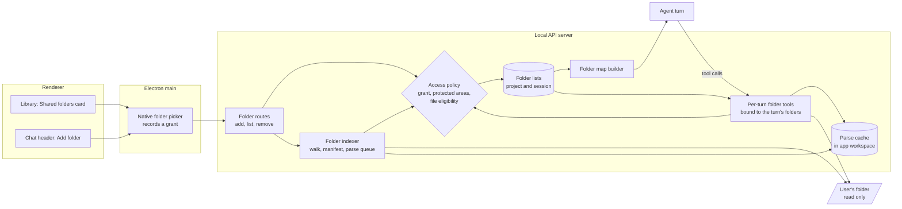
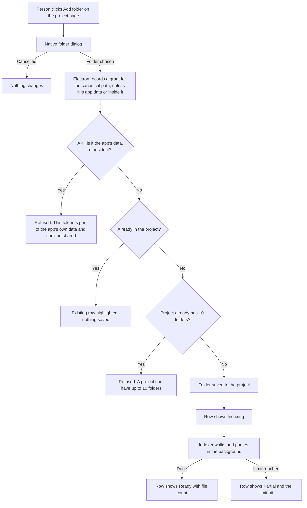
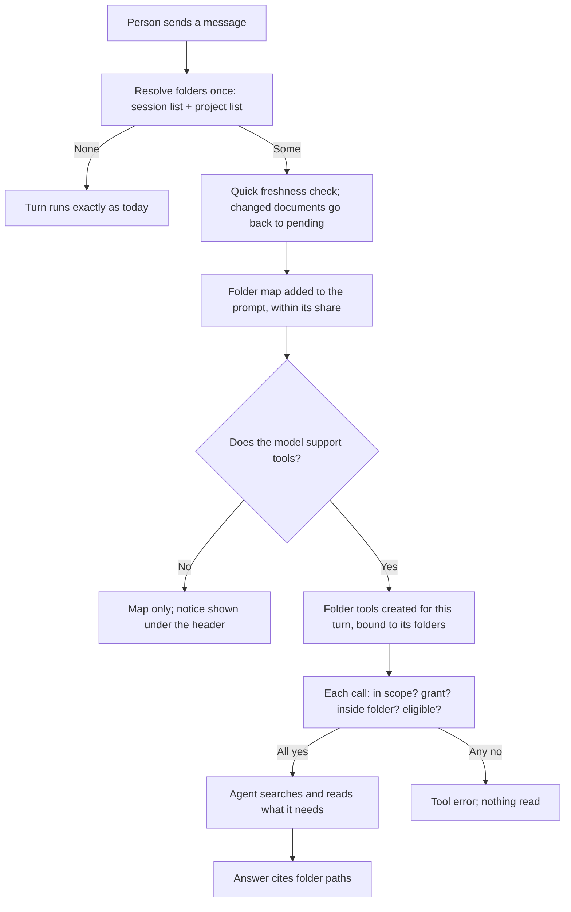
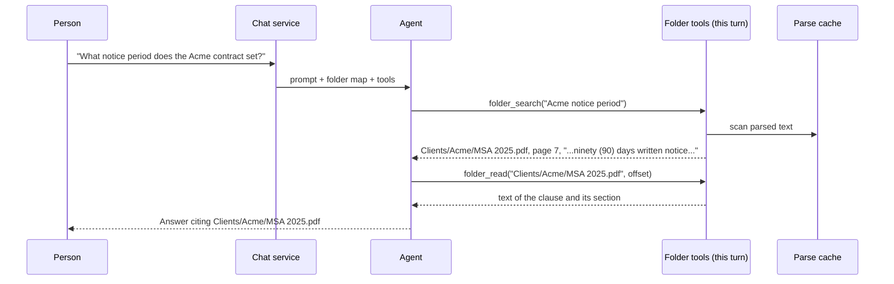

# Feature: Local folder access

## Summary

A person can give an agent read access to folders on their computer. They can
do it in two places:

| Where | What the person does | Who sees the folder |
| --- | --- | --- |
| Library, project page, new **Shared folders** card | Clicks **Add folder** and picks a folder in the macOS dialog. Repeats for more folders. | Every chat that belongs to the project, on its next turn |
| Run, chat header, new folder icon with the tooltip **Add folder** | Picks a folder for this chat only | This chat only |

The agent never receives the folder's contents in its prompt. Each turn it gets
a short **folder map**, which lists the folder's name, its size, and a capped
tree of its paths. It also gets three read-only tools: `folder_list`,
`folder_search` and `folder_read`. It looks inside a file only when the
question needs that file. Claude Code and Codex work the same way: they give
the agent a working directory and tools, not the directory's contents.

Managed Team and Workflow workers resolve the attached folders from the session
whose task the parent has already authorized. Every worker turn receives the
bounded map, with the same read-only adapters used by Agent chat. This includes
specialists whose persona has no general filesystem tools. Structured discussion
selection and synthesis calls receive the map and specialist evidence while
keeping their existing tool-free decision contract. Each worker turn resolves
current chat/project membership; a later folder attachment applies to the next
worker turn. Every tool call still rechecks the native grant. Nothing copies the
codebase into the task's uploaded-file snapshot.

Single files still go through the existing **Add files** control in the chat
composer. The header button adds folders only.

## Provider-independent folder tools

Both CLIs can already read a working directory. This app deliberately turns
that off, and the plan keeps it off.

| Fact | Evidence |
| --- | --- |
| Codex is forced into its read-only sandbox whenever the app's tool bridge is on, and its shell tool is disabled | `providers/codex.ts:199-224`, `providers/codex.ts:1062-1064` |
| Claude Code runs with its built-in tools switched off (`--tools ""`) and may call only the app's own tools | `providers/claude.ts:107`, `providers/claude.ts:133` |
| API providers such as OpenAI and OpenRouter have no filesystem at all | `domains/mcp/mcp-provider-support.ts:29-42` |
| grep and similar tools can't read PDF, DOCX or XLSX files | The app's file parser exists for this reason (`file-parser/index.ts:134-141`) |

App-defined tools give the same behavior on every provider that supports tools.
They read parsed text, so documents become searchable. And safety checks live
in one place.

## How it works



The pieces in order:

1. **Picking.** The renderer asks Electron for a folder. Electron shows the
   native dialog, resolves the real path, and records a grant for every folder
   it accepts. The renderer never types a path. This reuses the Batch picker's
   trusted-frame and dialog checks (`electron/batch-folder-picker.ts:43-55`),
   but not its grant exemption: the Batch picker skips the grant for folders
   inside the repository (`electron/batch-folder-picker.ts:60-70`), and a
   shared folder without a grant would fail SEC-2.
2. **Saving.** The API server checks the grant and the protected areas again,
   then adds the folder to the project's or the session's folder list.
3. **Indexing.** A background job walks the folder and writes a manifest of
   paths, sizes and modification times. It extracts text from documents into a
   cache inside the app workspace, with the parser in local-only mode. It never
   writes into the user's folder.
4. **Each turn.** When the turn starts, the server works out its folders: the
   session's own folders plus the folders of the session's project. That list
   is fixed for the turn. The chat service adds the folder map to the prompt
   and creates the three folder tools for this turn only, bound to that list.
5. **Tool calls.** The agent lists, searches and reads. Every call checks that
   the folder belongs to the turn, that the grant still exists, that the path
   stays inside the folder, and that the file is eligible.

## What the agent receives each turn

### The folder map

The map is one block of text, framed as untrusted content like uploads already
are (`services/session-chat-file-context.ts:63-65`). Example:

```text
<attached_folders trust="untrusted_user_content">
You can read these folders with folder_list, folder_search and folder_read.
Their contents are not in this message. Search or read before you answer
questions about them, and cite the paths you used.

<folder id="f_3k9" name="Contracts 2026" source="project">
  412 files, 180 MB. 290 PDF, 88 DOCX, 21 XLSX, 13 other.
  Index: ready.
  /
  ├── Clients/ (301 files)
  │   ├── Acme/ (42 files)
  │   ├── Globex/ (39 files)
  │   └── … 18 more folders
  ├── Templates/
  │   ├── NDA template.docx
  │   └── MSA template.docx
  └── Pricing 2026.xlsx
</folder>
</attached_folders>
```

**Size.** The map is counted in tokens with the shared estimator, not in
lines. It is part of the existing reference share, the 40% of the input window
that uploads and project references already use (`core/context-limits.ts:219-234`,
assembled at `services/agent-chat-service.ts:520-530`). A new registry entry,
`share.folderMap`, gives the map at most a quarter of that share. The map is
built first. Uploads and project files fill the rest. When the map is too big,
it shrinks in steps: deeper folders collapse into counts, then each folder
shrinks to its header line, then folders beyond the budget are named only.
The agent can always call `folder_list`.

**Names.** Folder names and file names come from the user's disk, so they are
escaped with the same function uploads use
(`services/session-chat-file-context.ts:72-78`). Control characters are
removed. A name longer than 120 characters is cut at a character boundary,
never inside a multi-byte character.

### The tools

| Tool | Input | Output |
| --- | --- | --- |
| `folder_list` | `folder`, optional `path`, optional `depth` | Eligible entries with name, type, size, modified date and status |
| `folder_search` | `query`, optional `folder`, optional `path` prefix | Matching files with path, line or page, and a short snippet. File-name matches rank first. Says when results are partial. |
| `folder_read` | `folder`, `path`, optional `offset` | Text of a plain text file, or of a parsed document, from `offset`, plus `next_offset` when more remains |

Search in version 1 is case-insensitive keyword matching. A file matches when
it contains every term. Results are ranked by how often the terms appear. The
agent can retry with other words.

### Folder scope: which folders a tool call may touch

The tool service is one shared object for the whole app
(`server/composition.ts:823-830`), and a built-in tool's enablement sees only
the agent's path (`domains/mcp/builtin-agent-tool-adapter.ts:57-62`). Two chats
using the same agent can run at the same time. So the folder list must never
live on the shared service.

| Rule | Detail |
| --- | --- |
| Scope is built per turn on the server | When the turn starts, the server resolves its folders and creates the three tool adapters for that turn, holding that list. This is how the agent-question tool is added today (`services/mcp-agent-tool-service.ts:553`). |
| The list can't change during the turn | Adding or removing folders, or moving the chat between projects, applies from the next turn. |
| A folder ID is a label, not a key | A tool call's `folder` must be one of the turn's folder IDs. An ID from another chat is refused as unknown, even if it is valid elsewhere. Path hashes and cache keys are never accepted as input. |
| The cache never adds access | A tool reads cached text only after the scope, grant, path and eligibility checks pass for the source file. |
| Revocation is checked on every call | Each tool call checks that the grant still exists. A revoked folder fails the next call with "Access to this folder was removed", even mid-turn. |
| Tools appear only with folders | A turn with no folders gets no folder tools. A turn with folders gets them whatever the agent's `tools:` line says. Other built-ins stay filtered by that line (`services/mcp-agent-tool-service.ts:547-551`). |

### Tool rounds and the live answer

Folder tools are ordinary tool calls inside the existing tool loop. The
[Agent chat live answer](flows/agent-chat-live-answer.md) flow stays as it is:
text from tool rounds is never shown (CS-02), and a turn makes at most
`MAX_PROVIDER_ROUNDS` requests, now 8, with the last one reserved for the
answer (CS-04, `contracts/agent-questions.ts:14`). Folder searches and reads
share that budget with the other tools.

### Models that can't use tools

In chat, Gemini, Qwen, Pi and the direct Anthropic connection fall back to a
plain call with no tools (`services/agent-chat-service.ts:1857-1864`,
`domains/mcp/mcp-provider-support.ts:29-42`). With folders attached, these
models get the map but can't open files. The chat shows a one-line notice
under the header: "This model can see folder names but can't open files. Use
a model with tool support to work with folder contents."

## File eligibility: one policy for every access

The walk, `folder_list`, `folder_search`, `folder_read` and on-demand parsing
all call one function that classifies a path. Skipping a file in the walk is
not what protects it. The tools enforce the same classification on every call.

| Class | Which paths | List | Search | Read | Parse on demand |
| --- | --- | --- | --- | --- | --- |
| `excluded` | Any path segment that starts with a dot (`.env`, `.git/`), `node_modules`, key files (`*.pem`, `*.key`, `*.p12`, `*.pfx`, `id_rsa*`, `id_ed25519*`), any symlink at any level, named pipes and other entries that are not regular files or folders, anything inside a protected area | Hidden | Never | Refused: "This path is not available" | Never |
| `unsupported` | Not plain text and not a document the parser reads | Shown with type and size | File name only | Refused: "This file type can't be read" | Never |
| `oversized` | A document over 50 MB | Shown, marked "too large to parse" | File name only | Refused: "This document is too large to read" | Never |
| `large text` | A plain text file over 10 MB | Shown | File name only | Allowed, 24 KB per call by offset | Not needed |
| `pending` | An eligible document not yet parsed, or changed since its last parse | Shown, marked "indexing" | Flagged "changed, re-indexing" | Parsed on demand, within its deadline | Yes |
| `ready` | Plain text up to 10 MB, or a parsed document | Shown | Full text | Allowed by offset | Not needed |

The refusal for `excluded` is the same message whether the path exists or not,
so the agent can't probe for hidden files.

### Unreadable, moved and cancelled

No failure is reported as an empty success.

| Situation | What the tools and the map say |
| --- | --- |
| The folder was moved, deleted or replaced through a parent symlink | "Folder not found at its saved path." from every tool, including search |
| The folder itself can't be read | "Can't read folder." The map shows the same status, never an empty, ready folder |
| A subfolder can't be read, or moves away during a walk | Listing shows it as `name/ (can't read)`. Search adds "Can't read N subfolders". The map says "partial (N folders can't be read)" |
| A file can't be read, or its path is too long for the system | Search lists it under "Can't read N files". `folder_read` answers "This file can't be read." |
| The turn is cancelled | The current call stops between directory entries or read windows and answers "Cancelled before it finished."; map building stops too |

## Indexing and the parse cache

### Per-file identity

The current parsers name their output after the source file's base name
(`file-parser/parsers/docx.ts:30`, `file-parser/parsers/pdf.ts:920`,
`file-parser/parsers/xlsx.ts:18`), and the manifest matches files by that name
(`file-parser/index.ts:79`). Sent to one output folder, `Clients/Acme/MSA.pdf`
and `Clients/Globex/MSA.pdf` would overwrite each other.

So every document gets its own output folder:

```text
<workspace>/folder-index/<folderKey>/
  manifest.json                     # path -> fileKey, size, mtime, generation
  files/<fileKey>/generation-<n>/   # one parsed document and its extracted assets
```

`folderKey` is a hash of the canonical folder path. `fileKey` is a hash of the
file's path relative to the folder root, as read from disk. Both are internal
names, never accepted from a tool call.

### Local-only parsing

The parser can send pages to an outside model. It builds an enricher from
environment variables (`file-parser/parsers/pdf.ts:817`), sends page text and
page images to it (`file-parser/parsers/pdf.ts:847`,
`file-parser/lm/openai.ts:130-169`), and turns this on when
`FILE_PARSER_LLM_ENABLED` or `FILE_PARSER_LM_ENABLED` is `1`
(`file-parser/lm/llm-model.ts:14-23`). The launcher passes the app's whole
environment to the parser (`electron/file-parser-launcher.ts:46-49`). So
writing to a different output folder does not by itself keep folder contents
on the machine.

Folder indexing runs the parser in an explicit local-only mode:

- A `--local-only` option makes the parser skip enrichment whatever the
  environment says.
- The launcher also removes the enrichment variables and API keys from the
  parser's environment for these runs.
- The folder cache only holds output from local-only runs. It never reuses
  parsed output from uploads or project files.
- OCR stays on, because it is local: it uses the bundled Tesseract language
  file (`file-parser/ocr/tesseract-engine.ts:124-141`).

### Scheduling and publishing

| Rule | Detail |
| --- | --- |
| One parse per file version | Jobs are keyed by folder, file, size and modified time. A background job and a `folder_read` asking for the same version share one parse. |
| Bounded work | At most 2 parser processes run at once across the app. Each folder has its own queue. `folder_read` moves its file to the front. |
| Deadlines | Each parse keeps the launcher's abort signal and its 5-minute timeout (`core/file-parser-launcher.ts:47`). A `folder_read` waits up to 60 seconds, then returns "Still parsing; try again shortly". |
| Atomic publish | A parse writes to a temporary folder. Before publishing, the indexer checks the source again. The publish happens only if the source's size and modified time are unchanged, the grant still exists, and the folder is still attached somewhere. Then it renames the folder into place and writes the manifest through a temporary file. |
| Newer always wins | A generation number only goes up. An older parse finishing late is discarded. A deleted source's entry and output are removed and are never brought back. |
| Restart | At startup, temporary folders are deleted. A manifest entry whose output is missing goes back to `pending`. |
| Retention | When a folder's last attachment is removed, or its grant is revoked, its jobs are aborted and its cache folder is deleted. |

### Freshness

At the start of each turn the indexer compares sizes and modification times
and drops deleted files. Plain text files are always read live, so they are
never stale. Changed documents go back to `pending`. The turn doesn't wait for
them.

### Status

A folder's status is `indexing`, `ready`, `partial` (hit a limit) or
`unavailable`. An `unavailable` folder carries a reason: `not_found` (moved or
deleted), `access_removed` (grant revoked) or `unreadable` (macOS permission or
I/O error). The UI shows the status, or the reason as text: "Folder not found",
"Access removed", "Can't read folder".

### Limits

| Limit | Value | What happens at the limit |
| --- | --- | --- |
| Folders per project | 10 | The next add is refused |
| Folders per chat, its own only | 10 | The next add is refused |
| Eligible files per folder | 5,000 | The walk stops; status `partial` |
| Document size to parse | 50 MB | The document is `oversized` |
| Document bytes parsed per folder | 2 GB | Remaining documents stay unparsed; status `partial` |
| Parsed output per folder | 1 GB | Same as above |
| Plain text file size for content search | 10 MB | `large text`: readable by offset, searched by name only |
| Bytes scanned per search | 200 MB within 5 seconds, shared by every folder the call searches | Results come back marked partial, with how many files were searched |
| Directory entries examined per operation | 50,000 | The walk stops and says it is partial |
| Time to build the folder map, all folders together | 2 seconds per turn | The map shows what it finished and marks the rest "partial (ran out of time …)"; the turn goes ahead |
| `folder_list` entries per call | 500 | `next_cursor` returned |
| `folder_search` hits | 20, snippets of 300 characters | Highest-ranked hits returned |
| `folder_read` per call | 24 KB of text, cut at a character boundary | `next_offset` returned, in bytes |
| Map | A quarter of the reference share | Shrinks as described in "Size" |

Without the per-folder byte budgets, 5,000 documents at 50 MB each could mean
about 250 GB of parsing.

## Where folder lists live

| Data | File | Notes |
| --- | --- | --- |
| Project folders | `<workspace>/projects/<id>/context/folders.json` | Kept beside `context/brief.md`, so `project.json` and its parser (`domains/projects/project-store.ts:344-370`) stay unchanged |
| Session folders | `<workspace>/sessions/<id>/folders.json` | Only folders added from the chat header |
| Grants | Its own list, `<app data>/shared-folder-grants.json`, using the Batch grant store's class (`domains/batches/batch-folder-grant-store.ts`, file mode 0600 at `:88`) | A grant means "the person picked exactly this folder in the native dialog". It never covers subfolders, and it is separate from Batch's grants, so a pick for one feature never widens what the other admits |
| Parse cache | `<workspace>/folder-index/<folderKey>/` | See "Per-file identity" |

A folder record, with a Zod schema in `contracts/`:

```ts
{
  version: 1,
  id: "f_3k9",            // label the agent uses; never authority
  path: "/Users/example/Contracts 2026",  // canonical, absolute
  label: "Contracts 2026",
  access: "read",         // "read-write" reserved for later
  addedAt: "2026-10-07T10:00:00Z"
}
```

**Which folders a turn gets.** The server resolves them when the turn starts.
It takes the session's own list, then looks up the session's project through
the membership store (`domains/projects/project-membership-store.ts:60`) and
adds that project's list. It removes duplicates by canonical path. Nothing is
copied into the session. The UI never sends a folder selection with the turn,
unlike the current project files selection
(`contracts/schemas/session-requests.ts:224`).

## Security rules

| ID | Rule |
| --- | --- |
| SEC-1 | Only Electron's main process can create a grant, and only from the native dialog. The handler refuses renderer arguments and non-main frames (`electron/shared-folder-picker.ts`). A chosen folder gets a grant unless it holds or sits inside the app data or the workspace; those are returned ungranted for the API to refuse. |
| SEC-2 | The API refuses to save a folder that has no grant for that exact folder in the shared-folder grant list. A grant on a parent folder, or a Batch grant, admits nothing. |
| SEC-3 | The protected areas are the app data folder, which holds provider settings, the browser profile and the grant list (`electron/main.ts:114`, `:219`, `:456-480`), and the workspace, which holds every chat's data and can be moved elsewhere with `PIPELINE_DESKTOP_WORKSPACE_PATH` (`electron/main.ts:120-126`). The API refuses a protected area itself and any folder inside one. A parent of a protected area, such as the home folder, can be shared: the tools and every walk refuse any path inside a protected area on every call. The Batch policy allows the workspace without a grant (`domains/batches/batch-folder-access.ts:35-40`), so shared folders get their own policy. |
| SEC-4 | Every operation first resolves the saved root with `realpath` and requires it to be the saved path itself, so a parent folder swapped for a symlink makes the folder "not found". Paths are then resolved one segment at a time: `..`, absolute paths, symlinks at any level, named pipes and excluded files are refused. A file is read only through a handle that is checked, by device and inode, to be the file its fully resolved path names. A directory is checked before and after its entries are read. |
| SEC-5 | Version 1 has no tool that writes, renames or deletes, and nothing writes inside the user's folder. |
| SEC-6 | Tool output is framed as untrusted content. A document that says "ignore your instructions" is data. |
| SEC-7 | Folder contents leave the machine only inside requests to the model the chat already uses. Folder indexing runs the parser in local-only mode. |
| SEC-8 | A tool call can reach only the folders resolved for its own turn. Folder IDs, file keys and cache paths are identifiers, never authority. |
| SEC-9 | Every tool call re-checks the grant. Revocation also aborts the folder's background parses and deletes its cached text. |

## UI

### Library: Shared folders card

The card sits under the existing Shared files card
(`ui/src/components/library/project-context-details.tsx:153-172`).

```text
┌ Shared folders ──────────────────────────────────── [+ Add folder] ┐
│ Every chat in this project can search and read these folders.      │
│ Files are never changed.                                           │
│                                                                    │
│ Contracts 2026   ~/Contracts 2026     412 files · Ready        ✕   │
│ Brand assets     ~/Design/Brand        88 files · Indexing     ✕   │
│ Old research     ~/Archive/Research    Folder not found        ✕   │
└────────────────────────────────────────────────────────────────────┘
```

Empty state uses `PanelEmptyState`: "No folders yet. Add a folder to let this
project's chats search and read it."

### Run: chat header button

The button goes in the header's right-hand group, which today only shows
errors (`ui/src/components/run/chat/chat-panel.tsx:1213-1220`).

```text
 [chat] Levanto Sage Model Versus JEV              [folder 3]
                                                       │
                     ┌─────────────────────────────────┴──┐
                     │ From project "test1"               │
                     │   Contracts 2026    412 · Ready    │
                     │   Brand assets       88 · Indexing │
                     │   Manage in Library →              │
                     │ This chat only                     │
                     │   Research notes     57 · Ready  ✕ │
                     │ [+ Add folder]                     │
                     └────────────────────────────────────┘
```

- With no folders, the button is a plain folder icon with the tooltip "Add
  folder". Clicking it opens the native dialog straight away.
- Clicking a folder's name, here or in the Library card, opens it in Finder
  or File Explorer. Electron's main process opens a path only when it is
  exactly a granted shared folder (`electron/shared-folder-picker.ts`,
  `registerSharedFolderOpener`; tests in `tests/unit/shared-folder-opener.test.ts`
  and the journey "clicking a folder's name in the chat popover opens that
  folder in the file manager").
- In a new chat that has not been saved yet, choosing a folder saves the chat
  first, the same way attaching a file does, and the folder is attached to it.
  Cancelling the dialog saves nothing.
- Every response is checked against the chat that sent it, so switching chats
  while a request is pending never changes the other chat's list.
- With folders, it shows a count. Clicking it opens the popover above.
- Project folders can't be removed from the chat. The popover links to the
  Library instead.
- A folder whose status is `unavailable` shows a warning icon on the button.

## Flows

### Flow A: add a folder to a project



### Flow B: add a folder to one chat

Same as Flow A, with three differences. The button is in the chat header,
and the folder is saved to the session's list. If the chat's project already
has the folder, the popover says so and nothing is added. The limit of 10
counts only the chat's own folders, not the ones it gets from its project.

### Flow C: a chat turn with folders





### Alternative flows

| Situation | Outcome |
| --- | --- |
| The person picks a parent of the app's data, such as their home folder | Accepted. The app's data beneath it never appears in listings, search, reads or the map. |
| The folder was moved or deleted | Status becomes `unavailable` with reason `not_found`. The map says so. Tools return "Folder not found at its saved path". The UI shows "Folder not found". |
| The person revokes the grant in Settings | The next tool call fails with "Access to this folder was removed", even mid-turn. Background parses stop and the cached text is deleted. Rows show "Access removed". |
| A tool call names a folder ID from another chat | Refused as an unknown folder. Nothing is read. |
| A chat is moved into or out of a project | From its next turn it gains or loses the project's folders and keeps its own. |
| Indexing is still running | The turn doesn't wait. Search covers parsed text, lists pending documents whose names match as "changed, re-indexing", and says how many are still pending. `folder_read` parses a pending document on demand. |
| Two documents share a name in different subfolders | Each has its own cache entry and returns its own text. |
| The agent asks for `.env`, `secret.key`, `node_modules/...` or a symlink inside the folder | Refused with "This path is not available". |
| A document is over 50 MB | Listed as too large. Reading it is refused. It is never parsed. |
| An agent asks for `../secrets.txt` | The tool returns an error. Nothing outside the folder is read. |
| An 11th folder is added to a project or a chat | Refused with "A project can have up to 10 folders" or "A chat can have up to 10 of its own folders". Nothing is saved. |

## Business rules and test mapping

The table maps rules to test boundaries. Test links describe coverage, not
execution evidence. Each row names the lowest boundary that can observe the rule. Exact rule matrices stay at the lower layers, and
the Electron journeys prove one user outcome each.

| ID | Required outcome | Test boundary and reason | Test file |
| --- | --- | --- | --- |
| LF-P1 | A folder attached to a chat lets its next agent turn read a known file through `folder_read`, while the prompt carries only the map | Integration through the real API and tool loop, with a fake provider at the HTTP boundary | `tests/integration/shared-folders-chat-turn.test.ts` |
| LF-01 | The picker refuses renderer arguments and non-main frames, returns the canonical path, and grants every accepted folder, including one inside the repository, except one that holds or sits inside the app data or the workspace | Unit, mirroring the Batch picker's tests | `tests/unit/shared-folder-picker.test.ts` |
| LF-02 | The API refuses a folder without a grant, and a folder that overlaps the app data folder or the workspace in either direction | Integration with the real loopback API and temp directories | `tests/integration/shared-folders-api.test.ts` |
| LF-03 | A chat in a project gets every project folder plus its own on its next turn, with no selection sent. Moving the chat, or removing a folder, applies on the next turn. | Integration across membership, folder store and turn assembly | `tests/integration/shared-folders-turn.test.ts` |
| LF-04 | The prompt holds the folder map and never file contents. Names are escaped. Long and non-Latin names stay inside the map's share. | Unit on the map builder with a temp folder | `tests/unit/folder-map-context.test.ts` |
| LF-05 | Tools refuse `..`, absolute paths, symlinks at any level, excluded files, and a protected-area file under an attached parent folder | Unit with real temp folders, real symlinks and a fake protected area | `tests/unit/folder-access.test.ts` |
| LF-06 | `folder_search` finds text inside a PDF, and the user's folder gains no files | Integration with the real file parser | `tests/integration/folder-index-documents.test.ts` |
| LF-07 | After a file changes, `folder_read` never returns the old content: it returns the new content, or "Still parsing; try again shortly" when the parse is not done within its wait. Search flags the file until it is re-parsed. A deleted file disappears on the next turn. | Integration on the indexer and tools with the real parser | `tests/integration/folder-indexer-freshness.test.ts` |
| LF-08 | Folder tools appear only when the turn has folders, whatever the `tools:` line says. Two concurrent turns of the same agent in different chats each reach only their own folders. A folder ID from another chat is refused. | Integration through the real API with two sessions and event barriers; unit on the adapters | `tests/integration/folder-tools-scope.test.ts`, `tests/unit/folder-tool-adapters.test.ts` |
| LF-09 | A model without tools gets the map, and the chat shows the notice | Integration on the real no-tools path, component test for the notice, desktop check | `tests/integration/folder-tools-unavailable.test.ts`, `ui/src/components/run/chat/__tests__/chat-panel-folder-tools-notice.test.tsx`, `tests/electron/shared-folders.spec.ts` |
| LF-10 | A folder added in Library appears in an existing project chat's popover, and that chat's next turn reads a known file from it with no selection sent | Electron journey with the real API and filesystem and a stand-in provider | `tests/electron/shared-folders.spec.ts` |
| LF-11 | A folder added from the chat header lets the next turn read a known `.md` file, and the folder is still attached after the app restarts | Electron journey with a stand-in provider, never a real one | `tests/electron/shared-folders.spec.ts` |
| LF-12 | After revocation the next tool call fails, even mid-turn, background parses stop and cached text is deleted | Integration with a deterministic barrier inside a tool call | `tests/integration/folder-revocation.test.ts` |
| LF-13 | With enrichment turned on in the parent environment and a loopback sentinel as its endpoint, folder indexing sends zero requests | Integration with the real parser and a real loopback server | `tests/integration/folder-index-local-only.test.ts` |
| LF-14 | Two documents with the same name in different subfolders each return their own known text | Integration with the real parser | `tests/integration/folder-index-documents.test.ts` |
| LF-15 | Background and on-demand parses of one file version run once. A late older parse never replaces a newer one, and a deleted file is never brought back. | Unit with deterministic barriers, no sleeps | `tests/unit/folder-parse-queue.test.ts`, `tests/unit/folder-index.test.ts` |
| LF-16 | An oversized document is listed, can't be read, and is never parsed. A large text file is readable by offset and searched by name only. | Unit with temp files | `tests/unit/folder-access.test.ts` |
| LF-17 | A search that hits the scan budget returns partial results and says how many files it searched | Unit with an injected budget | `tests/unit/folder-access.test.ts` |
| LF-18 | Session and project folder lists survive reopening the stores | Integration on the stores with a real temp workspace | `tests/integration/shared-folder-store.test.ts` |

High-risk rules needing a mutation proof under `AGENTS.md`: LF-02, LF-03,
LF-05, LF-07, LF-08, LF-12, LF-13 and LF-15.

See [the local-folder flow](flows/local-folder-access.md) for business rules and test mappings.
