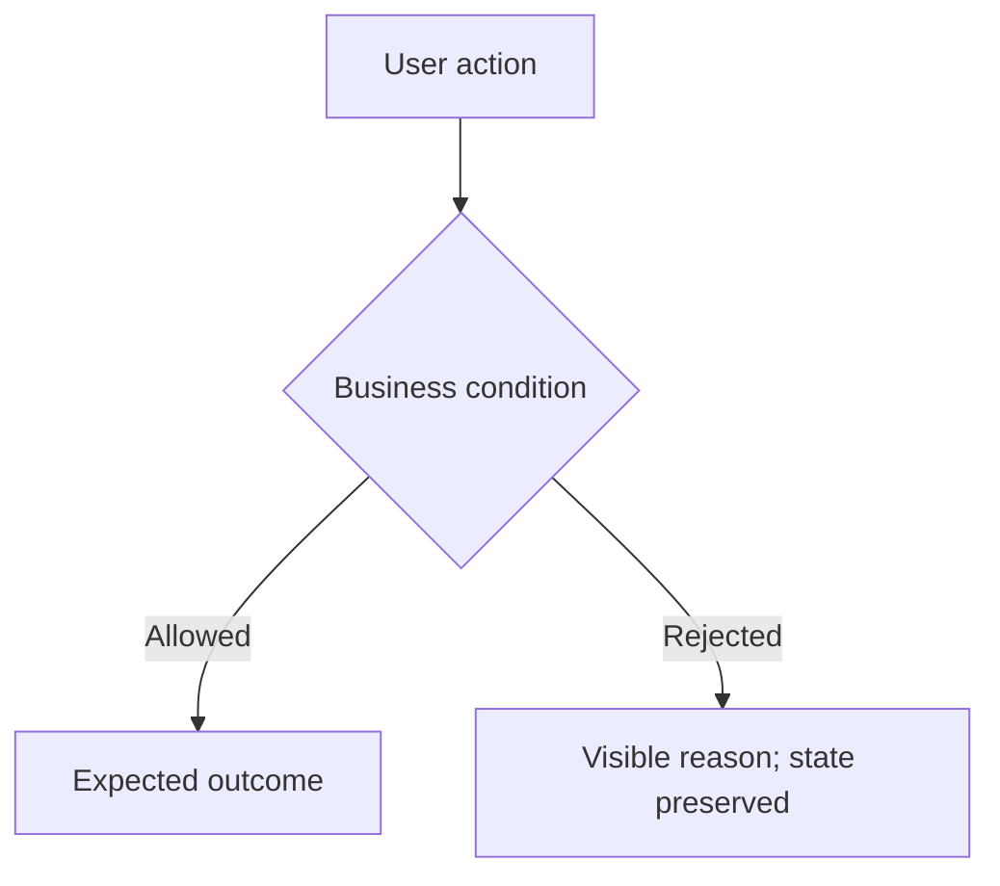

# Business flows

Use this index before changing behavior, as required by
[AGENTS.md](../../AGENTS.md#business-flow-discovery). Flows describe intended
business behavior across actions, decisions, and state changes. Tests check
specific expectations; neither a diagram nor a test link proves current correctness.

## Index

Read every row, then open the relevant documents. Match the request's meaning
and the code areas involved, not just keywords. Shared code can affect several
flows. Revisit the index when the implementation scope changes.

| Flow | Consult when changing | Code entry points |
| --- | --- | --- |
| [First-load provider information](provider-startup-loading.md) | First Settings/model-selector display, saved discovery metadata and background refresh after restart | `services/provider-settings-service.ts`, `server/routes/provider-settings.ts`, `ui/src/contexts/provider-catalog-context.tsx` |
| [Run sidebar navigation](run-sidebar-navigation.md) | Selecting Run sessions or chat targets; shared sidebar search; initial Create resource tab | `ui/src/components/sidebar/run-sessions-sidebar.tsx`, `ui/src/components/run/run-target-sidebar.tsx`, `ui/src/hooks/use-create-workspace-controller.ts` |
| [Team creation and recovery](team-build-recovery.md) | Create a Team; selected configuration; failed or interrupted builds; retry; discard; reopening; saved build restoration | [Recovery rules](../../contracts/resource-build-recovery.ts), [build service](../../services/resource-architect-service.ts), [API routes](../../server/routes/resource-architect.ts), [Create chat state](../../ui/src/components/create/agents-and-teams/use-resource-architect-chat.ts), [build card](../../ui/src/components/create/agents-and-teams/resource-creation-card.tsx) |
| [Team target confirmation](team-target-confirmation.md) | Adding Agents to an existing Team inferred from chat; confirming its exact ID before saving an update proposal | `domains/resource-architect/resource-update-policy.ts`, `services/resource-architect-service.ts` |
| [Agent chat live answer](agent-chat-live-answer.md) | How an Agent chat answer reaches the chat panel on the native tool route; tool rounds and planning text; the streamed final request; provider errors, truncation and round limits during it; which callers stay buffered | [Tool loop](../../domains/provider/provider-tool-loop.ts), [Chat Completions adapter](../../domains/provider/openai-chat-completions-tool-adapter.ts), [MCP turn service](../../services/mcp-agent-tool-service.ts), [agent chat service](../../services/agent-chat-service.ts) |
| [Agent progress](agent-progress.md) | Observed provider activity, tool execution, retries, agent-reported summaries/tasks, and recovery after reopening a running chat | `providers/claude-progress.ts`, `services/agent-chat-service.ts`, `contracts/agent-text-stream.ts`, `ui/src/components/shared/agent-progress.tsx` |
| [Agent dialogue](agent-dialogue.md) | Discussion mode or Talk to each other; repeated Agent turns and pass filtering; interjections, pause, Stop, limits and continuation; dialogue recovery and session ownership; text or voice delivery | [Feature document](../feature-agent-dialogue.md), [dialogue service](../../services/agent-dialogue-service.ts), [Agent picker](../../ui/src/components/run/pickers/agent-picker.tsx), [chat panel](../../ui/src/components/run/chat/chat-panel.tsx) |
| [Voice control through MCP](voice-control-mcp.md) | Enrolled voice clients; authenticated local MCP tools; questions, answers and task attention; opening chats in the desktop; outbound speech and dialogue progress | [Feature document](../feature-voice-control-mcp.md), [MCP runtime](../../server/voice-control/voice-control-runtime.ts), [voice link](../../server/voice-control/voice-layer-link.ts), [desktop entry](../../electron/main.ts) |
| [Session task worker recovery](session-task-worker-recovery.md) | Reconciling a task whose worker may still run; process identity and groups; restart and broker identity; cancelling a task whose process cannot be verified; admission grants and slots | [Recovery manager](../../domains/sessions/task-recovery-manager.ts), [task queue](../../services/task-queue.ts), [process supervisor](../../domains/sessions/task-process-supervisor.ts) |
| [Team discussion partial answer](team-discussion-partial-answer.md) | Failed Team chat participants; follow-up quorum; partial synthesis and recovery; bounded lead synthesis near the discussion time limit | `engines/discussion.ts`, `core/discussion-continuation-control.ts`, `team-runtime/discussion-autostart.ts` |
| [Team chat uploaded files](team-chat-uploaded-files.md) | Uploaded reference text reaching the discussion lead, selected specialists and synthesis | `services/task-service.ts`, `contracts/team-chat-brief.ts`, `domains/delegation/delegated-discussion-autostart.ts` |
| [Document consumption](document-consumption.md) | Uploaded and selected project documents reaching admitted workers; scoped full-source reads, whole-document coverage, recovery, and accurate consumption status | `domains/sessions/task-admission-manager.ts`, `services/task-service.ts`, `services/agent-chat-service.ts`, `domains/team-files/team-file-context.ts` |
| [Local folder access](local-folder-access.md) | Attaching local folders to a chat or a project; folder grants and protected app data; which folders Agent and managed Team/Workflow turns get; folder tools, their scope and file eligibility; the folder map in the prompt | [Feature document](../feature-local-folder-access.md), [MCP turn service](../../services/mcp-agent-tool-service.ts), [agent chat service](../../services/agent-chat-service.ts), [Batch folder picker](../../electron/batch-folder-picker.ts) |
| [Multiple chat windows](multi-window.md) | Opening chat windows; shared replies and task discovery; window focus; registered-window IPC | `electron/app-windows.ts`, `electron/main.ts`, `ui/src/components/run/chat/use-conversation-stream.ts` |
| [Chat-confirmed workflow launch](chat-workflow-launch.md) | Chat-confirmed Workflow admission, selected worker model, quota recovery, continuous worker-to-outcome display and YouTube screenshot recovery | [Launch tool adapter](../../services/workflow-launch-tool-adapter.ts), [session message turn](../../services/session-service.ts), [conversation stream](../../ui/src/components/run/chat/use-conversation-stream.ts), [worker tools](../../services/mcp-agent-tool-service.ts), [browser](../../domains/browser/browser-manager.ts) |
| [Requested YouTube document delivery](youtube-requested-delivery.md) | Requested Markdown/Word formats, takeaway versus instructional purpose, screenshot grounding, portable assets and primary manual delivery | `services/youtube-manual-coordinator.ts`, `domains/youtube/`, `workflows/runner.ts`, `ui/src/components/markdown-viewer.tsx` |
| [Resource Library lifecycle](resource-library.md) | Reusable skill ingestion, exact Agent pins, edit/history/restore, detach, restart, runtime snapshots, ZIP packages, migration approval, and concurrent Team publication | `domains/resource-library/`, `services/resource-library-service.ts`, `server/routes/resource-library.ts`, `ui/src/components/library/` |
| [Canvas workspace](canvas-workspace.md) | Document tabs and window modes; verified Markdown editing, selected-text proposals, draft conflicts, HTML isolation, Office previews and chat-delivered file revisions, saved-Markdown Word snapshots and shared theme | [feature guide](../feature-canvas.md) |

The catalog covers only the flows above. Absence from this table means undocumented,
not unaffected or untested. Trace the code and existing tests for areas not listed.

## Keeping flows useful

- Create a flow for a meaningful sequence, saved-state lifecycle, recovery path,
  or feature interaction. An isolated rule can be expressed by its test.
- Update an existing flow when its expected behavior changes. Reading a flow
  does not require editing it. Add documents only for work within the task's scope.
- Keep one coherent business operation per document. Use plain language for
  the behavior and a Mermaid diagram when it makes branches easier to understand.
- Give rules stable identifiers. Link tests by relative file path and exact test
  name; optional line anchors help navigation but can drift when files change.
- Label future behavior as proposed until implemented. Resolve open questions
  that change implementation before coding. A gap is not proof of an absent test:
  distinguish coverage not investigated, test planned, and test located.
- Choose test boundaries by behavior and risk. A short flow may need Electron;
  a complex decision may need only a unit test. Reuse existing tests.
- Record verification with its scope and limitations. Do not retain an old
  "passes" claim as if it describes the current checkout.
- At handoff, identify reviewed flows, updated rules, checks run, and remaining
  gaps. Keep the index links current when modules or documents move.

## Authoring template

Copy this structure into a descriptively named Markdown file in this directory.
Use a numbered flow if a diagram would add no clarity. Omit irrelevant branches.

````markdown
# Business workflow: <operation>

## Scope and starting conditions

Actor, trigger, necessary state, and what this document does not cover.
Identify whether this describes existing expectations or a proposed change.

## Flow



## Alternative flows

Relevant failure, recovery, cancellation, or interaction sequences and outcomes.

## Business rules and test mapping

| ID | Required outcome | Test boundary and reason | Test file and exact name, or gap |
| --- | --- | --- | --- |
| FLOW-01 | Observable rule | Lowest sufficient boundary | Existing test or explicitly planned coverage |

## Verification and open questions

State whether tests were located, run, or not investigated. For runs, record
the command, result, and revision or date, plus substituted boundaries and limits.
List undecided behavior separately from known test gaps.
````
