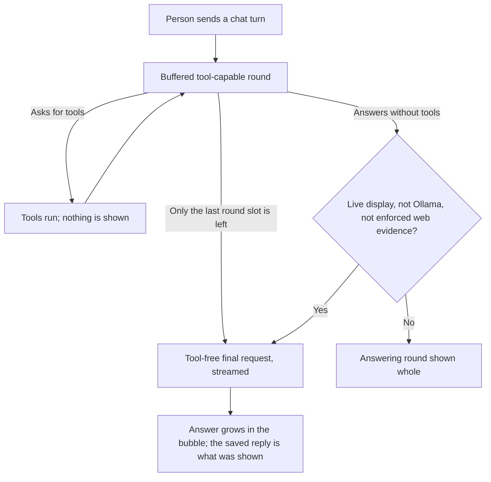

# Business workflow: stream an Agent chat answer through the tool loop

## Scope and starting conditions

A person sends a chat turn to an Agent that runs on a configured API
connection, with the chat panel open. Every Agent has `create_file`, so the
turn runs the native tool loop. This document covers how that turn's answer
reaches the chat panel. It does not cover Team members, workflow steps or MCP
workers, which have no live display, or CLI providers.

This flow describes answer text. [Agent progress](agent-progress.md) is a separate
metadata display: an explicit Agent report or observed tool phase is not the
tool-round answer prose excluded by CS-02.

## Flow

## Alternative flows

- A round that returns text together with tool calls is planning. Its text is
  never shown or saved.
- The final reply asks for a tool anyway. The turn fails with
  `invalid_provider_response`, and no tool runs.
- The provider reports an error or sends a malformed frame during the stream.
  The turn fails with the same classification other provider failures get,
  and the connection is closed.
- The stream stops at the token limit. The bubble closes as truncated, and no
  answer is kept.
- Explicitly configured Ollama connections, enforced web evidence turns, and
  callers without a live display keep one buffered request per round.

## Business rules and test mapping

| ID | Required outcome | Test boundary and reason | Test file and exact name, or gap |
| --- | --- | --- | --- |
| CS-01 | A displayed answer reaches the chat panel while the provider is still sending it, and the saved reply equals what was shown. | Electron for visible growth; integration for hub timing through the real service, loop, adapter and HTTP. | `tests/electron/agent-chat-streaming.spec.ts`, "chat text grows while the turn is running, then matches the saved reply"; `tests/integration/agent-chat-live-final-answer.test.ts`, "R1: the first streamed chunk reaches the chat hub while the provider still holds the rest of the answer" |
| CS-02 | Text from a tool-capable round is never shown or saved, including text returned together with tool calls. | Integration: every hub frame and the saved reply. | `tests/integration/agent-chat-live-final-answer.test.ts`, "R2: a buffered tool-capable round that returns prose together with tool calls publishes none of that prose" |
| CS-03 | The answer comes from a streamed, tool-free request that repeats the answering round's messages, model and settings. | Unit: the request body. | `tests/unit/provider-tool-loop.test.ts`, "with a live observer the answer streams from a tool-free final request sent as the answering round was" |
| CS-04 | A turn sends at most `MAX_PROVIDER_ROUNDS` requests; the last slot is the answer even when every earlier round calls a tool. | Integration for request count and persisted usage; unit for the loop. | `tests/integration/agent-chat-live-final-answer.test.ts`, "R5: tool-capable rounds use at most MAX_PROVIDER_ROUNDS - 1 requests, and the last slot of the budget is always the streamed tool-free answer"; `tests/unit/provider-tool-loop.test.ts`, "with a live observer the last slot of maxRounds is the final request, even when every round calls a tool" |
| CS-05 | A final reply that asks for a tool fails the turn and runs no tool. | Unit: the loop's decision. | `tests/unit/provider-tool-loop.test.ts`, "a final request answered with tool calls fails the turn and runs none of them" |
| CS-06 | A provider error in the stream keeps its classification: an exhausted quota or a rejected key is final, a rate limit is retryable. The provider's text is not shown, and the connection is closed. Malformed or cut frames are retryable failures. | Integration over real HTTP. | `tests/integration/agent-chat-live-final-answer.test.ts`, "R6: an error frame under HTTP 200 on the final request keeps its classification (…), keeps its prose out, and closes the connection" for three cases; "R6: a malformed frame on the final request is a sanitized retryable failure, and the connection is closed"; "R6: a final stream that ends part-way through a frame is a sanitized retryable failure" |
| CS-07 | A stream stopped at the token limit closes as truncated and keeps no answer. The response size limit covers the whole stream. | Integration and unit. | `tests/integration/agent-chat-live-final-answer.test.ts`, "R6: a streamed final answer that stops at its token limit closes as truncated, and no answer is kept" and "R6: a streamed final answer larger than the response bound fails the turn, though every frame is small"; `tests/unit/provider-tool-loop.test.ts`, "a streamed final answer that stops at its token limit is a truncation, and no whole answer is reported" and "the response bound covers the whole streamed final answer, not each frame" |
| CS-08 | Without a live display, with enforced web evidence, or on an explicitly configured Ollama connection, each round is one buffered request and no extra request is sent. | Unit for the loop; integration for enforcement and for Ollama at the HTTP boundary. | `tests/unit/provider-tool-loop.test.ts`, "without a live observer every round is one buffered request and the answering round is the answer"; `tests/integration/mcp-cli-agent-tool-service.test.ts`, "enforced web evidence publishes only the post-validation answer on the native route"; `tests/integration/agent-chat-live-final-answer.test.ts`, "Ollama: a configured Ollama connection keeps one buffered request per round and shows the answering round whole" |
| CS-09 | Shadow web-evidence telemetry compares the complete displayed answer. | Integration. | `tests/integration/agent-chat-live-final-answer.test.ts`, "R8: shadow web-evidence telemetry compares the complete streamed answer, not its first delta"; `tests/integration/mcp-cli-agent-tool-service.test.ts`, "shadow telemetry reports what the display stream actually showed, separately from what persisted" |
| CS-10 | Each selected speaker gets its own growing bubble, and one speaker's failure does not stop the others. | Electron: visible bubbles and saved speaker pairs. | `tests/electron/agent-chat-streaming-multi-speaker.spec.ts`, "each selected agent gets its own bubble, closing independently" and "a failing speaker does not stop the speakers around it" |
| CS-11 | A reply that settles after the user has come back to its session appears there without the session being reopened. | Component for the remount; Electron for the real remount and API. | `ui/src/components/run/chat/__tests__/chat-panel-conversation-races.test.tsx`, "shows a reply that settles after the person has come back to its conversation"; `tests/electron/chat-session-switch-streaming.spec.ts`, "a reply that settles after the user has come back to its session appears there without reopening it" (Red on a renderer built before the fix; Green not yet run) |

## Coverage boundaries

Test mappings describe intended coverage; run the relevant checks against the current checkout.

Local provider fixtures do not establish live paid-provider behavior. The total request deadline over a long streamed answer needs coverage separate from ordinary streaming.
