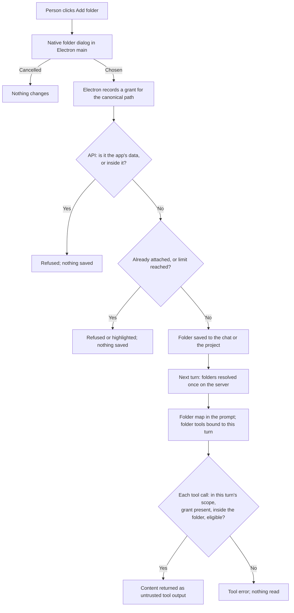

# Business workflow: give an agent read access to a local folder

## Scope and starting conditions

Desktop folder capabilities accept the main frame of any registered app window;
foreign windows and subframes remain refused. The multi-window mapping is
[MW-05](multi-window.md), including native and folder-handler tests.

A person attaches a folder on their computer to one chat, from the chat
header, or to a project, from the Library. The chat's Agent or managed
Team/Workflow worker can then list, search and read that folder's files through
tools, without the files entering the prompt. Design detail, limits and evidence are in
[the feature document](../feature-local-folder-access.md).

All four phases are implemented on branch `cwik-tech/local-file-access`:
chat and project folders, documents through a local-only parse cache,
statuses, the Settings grant list and the no-tools notice.

Out of scope: writing to folders, uploads, and the existing project Shared
files.

## Flow

## Alternative flows

- The folder was moved or deleted, or a parent folder was swapped for a
  symlink: every tool, search included, answers "Folder not found at its saved
  path", and the map shows the same.
- The folder or a subfolder can't be read: tools say so ("Can't read
  folder.", or the unreadable subfolders are named); nothing is reported as an
  empty success.
- The turn is cancelled: the current tool call and map building stop and say
  so.
- The grant is revoked: the next tool call fails, even in a running turn.
- A tool call names a folder from another chat: refused as unknown.
- Managed Team/Workflow contributors resolve folders from their authorized
  task's session at the start of each worker turn. Discussion selection and
  synthesis receive the map; their structured decision calls remain tool-free.
  Specialist turns can list, search and read, including nested codebases, even
  when their persona declares no general filesystem tools. Folder changes apply
  to the next worker turn; revocation stops the next tool call in a running turn.
- The model has no tool lane: it gets the map only, and the chat says so.
- The voice-control discovery folder and its grants are protected app data.
  Attaching them is refused even with a native grant. Attaching a parent is
  allowed, while its folder map, searches and reads exclude those credentials.

## Business rules and test mapping

Rules LF-01 to LF-18 are defined with their planned tests in
[the feature document](../feature-local-folder-access.md#business-rules-and-test-mapping).
Rows move here as their tests are written and run.

| ID | Required outcome | Test boundary and reason | Test file and exact name, or gap |
| --- | --- | --- | --- |
| LF-T1 | A folder attached in the chat header lets a selected Team inspect both nested codebases and display an answer grounded in each specialist's actual reads | Electron through the native grant, folder API, Team worker bridge and real filesystem; paid model and native dialog replaced | `tests/electron/team-shape-discussion-journey.spec.ts`, "a Team reads both nested codebases from a folder attached in the chat header" |
| LF-T2 | A managed worker receives the map and folder tools, cannot use another chat's folder ID, and loses reads immediately after grant revocation | Integration with a real task process, folder/grant stores, worker service, HTTP model boundary and tool loop | `tests/integration/worker-folder-access.test.ts` |
| LF-P1 | A folder attached to a chat lets that chat's next agent turn read a known file through `folder_read`, while the prompt carries only the folder map | Integration through the real API, folder store, tool service and tool loop, with a fake provider at the HTTP boundary | `tests/integration/shared-folders-chat-turn.test.ts`, "a folder attached to a chat lets its next agent turn read a file, while the prompt carries only the map" |
| LF-11 | A folder added from the chat header lets the next turn read a known file, and stays attached after a restart | Electron journey with the native dialog replaced and a fixture provider connection | `tests/electron/shared-folders.spec.ts`, "a folder added from the chat header lets the next turn read a known .md file, and the folder is still attached after the app restarts" |
| LF-03 | Every chat in a project gets all the project's folders on its next turn, with no selection sent; joining or leaving the project applies on the next turn | Integration through the real API and tool loop with a fixture provider | `tests/integration/shared-folders-turn.test.ts`, "a chat in a project gets every project folder and its own on its next turn, with no folder selection sent", "a chat gains the project folders on its next turn after joining, and loses them after leaving, keeping its own" |
| LF-10 | A folder added in Library reaches an existing project chat's popover and its next turn | Electron journey | `tests/electron/shared-folders.spec.ts` (second journey) |
| LF-06 | Text inside documents is searchable and readable through the folder tools, and the user's folder gains no files | Integration through the real API with the real parser | `tests/integration/shared-folders-documents-turn.test.ts`, "a turn reads and searches text inside a PDF in an attached folder, and the folder gains no files" |
| LF-07 | After a document changes, `folder_read` never returns the old text | Integration with the real parser | `tests/integration/folder-indexer-freshness.test.ts`, "after a document changes, folder_read returns its new text and never the old" |
| LF-13 | Folder indexing never contacts an outside model, whatever the environment says | Integration with the real parser and a loopback sentinel | `tests/integration/folder-index-local-only.test.ts`, "a local-only parse sends nothing to the enrichment endpoint the parent environment names, and still reads pixel-only text" |
| LF-15 | One parse per document version; older parses never win; deleted files never return | Unit with deferred jobs | `tests/unit/folder-parse-queue.test.ts`, `tests/unit/folder-index.test.ts` |
| LF-12c | Revoking a grant, removing a folder's last attachment, or deleting its chat or project stops its parses and deletes its parsed text | Integration | `tests/integration/folder-revocation.test.ts`; `tests/integration/shared-folder-owner-deletion.test.ts`, "deleting the chat that held a folder's last attachment stops its parses and deletes its parsed text" |
| LF-09 | A turn with folders on a model without tools marks its reply, and the chat shows the notice | Integration on the real no-tools path; component test | `tests/integration/folder-tools-unavailable.test.ts`; `ui/src/components/run/chat/__tests__/chat-panel-folder-tools-notice.test.tsx` |
| LF-21 | Revoking a shared folder in Settings stops the agent's next tool call on it | Integration through the real API | `tests/integration/shared-folder-grants-settings.test.ts`, "revoking a shared folder grant in Settings stops the agent reading that folder on its next tool call" |
| LF-22 | A moved folder shows "Folder not found", a revoked one "Access removed" with the next tool call refused, and a model without tools shows the notice, in the desktop app | Electron journeys with fixture connections | `tests/electron/shared-folders.spec.ts`, "a folder moved away while attached shows Folder not found in the chat popover, with a warning on the header button", "revoking a shared folder in Settings shows Access removed for that folder in the chat popover, and the next turn's tool call is refused", "a chat whose agent cannot use tools shows the no-tools notice after a turn with folders" |
| LF-02 | A folder without a grant, or the app data or workspace or a folder inside them, is refused; a parent such as the home folder is accepted | Unit for the policy on real directories; integration for the API status codes | `tests/unit/shared-folder-access-policy.test.ts`, "a parent of the app data, such as the home folder, is refused even with a grant" and siblings; `tests/integration/shared-folders-api.test.ts`, "folders overlapping the app data or the workspace are refused in both directions, even when granted" |
| LF-05 | Paths leaving the folder, symlinks and excluded or protected files are refused on every call | Unit with real temporary folders and symlinks | `tests/unit/folder-access.test.ts`, "paths that leave the folder are refused, and the refusal reads the same as a missing file", "excluded files are refused when named directly, not only skipped by a walk", "a path under an attached folder that lies inside the app data is refused" |
| LF-05v | The configured voice-control discovery folder and its grants cannot be attached or read, including beneath an attached parent; ordinary evidence beneath that parent stays readable | Integration through the real API and dialogue tool loop, with synthetic credentials in temporary folders | `tests/integration/voice-control-folder-protection.test.ts`, "the configured voice discovery folder and its grants cannot be attached even when picked", "dialogue folder tools beneath an attached parent expose evidence without exposing voice-control credentials" |
| LF-08 | Overlapping turns of one agent in two chats each reach only their own folder | Integration through the real API with event barriers; unit for the adapters | `tests/integration/folder-tools-scope.test.ts`, "overlapping turns of one agent in two chats each reach only their own folder"; `tests/unit/folder-tool-adapters.test.ts`, "a folder ID from another chat's turn is refused, and that folder is not read" |
| LF-12 | Revoking a grant stops the next tool call of a running turn | Unit on the adapters | `tests/unit/folder-tool-adapters.test.ts`, "revoking the grant stops the next call of a turn that is already running". Background parses and cached text: see LF-12c |
| LF-05b | A parent folder swapped for a symlink, before or during a turn, exposes nothing outside the root | Unit through the adapters and the map, with real grants, policy and symlinks | `tests/unit/folder-tool-adapters.test.ts`, "a folder whose parent was swapped for a symlink after it was attached is refused, and nothing outside is read"; `tests/unit/folder-map-context.test.ts`, "a folder whose parent was swapped for a symlink is mapped as not found, and nothing outside is named"; `tests/unit/folder-access.test.ts`, "a read whose folder is swapped out while its path is resolved returns nothing from outside" |
| LF-17b | One search call has one deadline and one byte budget across all its folders, and every tool and the map stop when the turn is cancelled | Unit with injected clocks, limits and AbortSignal | `tests/unit/folder-tool-adapters.test.ts`, "one search over several folders shares one scan budget, and says where it ran out", "a tool call from a turn that was already cancelled reads nothing"; `tests/unit/folder-map-context.test.ts`, "a cancelled turn stops building the map, before or during the walk", "a map that runs out of time shows the folders it finished, marks the rest partial with the reason, and returns" |
| LF-19 | A moved or unreadable folder is never reported as an empty success | Unit with real folders and permissions | `tests/unit/folder-tool-adapters.test.ts`, "a search of a folder that was moved away fails instead of finding nothing"; `tests/unit/folder-access.test.ts`, "a search of a folder that was moved away reports it as not found, not as no matches" |
| LF-20 | A folder chosen in an unsaved chat saves that chat and attaches to it; responses never change another chat | Component test with the network, picker and save callback replaced | `ui/src/components/run/chat/__tests__/chat-folder-button.test.tsx`, "a folder chosen in a draft chat saves the chat and is attached to it", "a folder chosen in a draft chat is not attached to the saved chat the sidebar selects before the draft leaves the screen", "an attach the server applies after its chat was left and opened again appears in the chat" |

## Coverage boundaries

Test mappings describe intended coverage; run the relevant checks against the current checkout.
