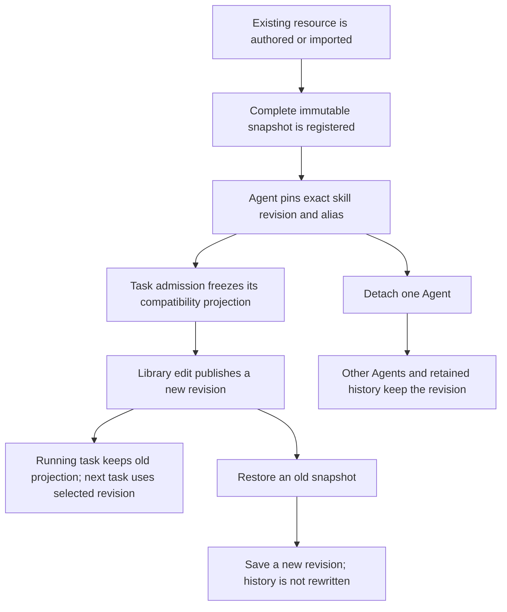

# Business workflow: retain and compose reusable resources

## Scope and starting conditions

Behavior contract for Library’s Skills, Agents, Teams, and underlying package lifecycle. Packages is hidden from the visible Library navigation; its implementation and retained data remain. Projects keeps its existing behavior and remains Library's initial section. Create and Run retain their existing UI and authoring flows.

The user starts with existing root or Agent-local skills, or with an empty personal Library. Permanent deletion, Git synchronization, marketplace installation, and automatic propagation of edits to other Agents are outside this flow.

## Flow

## Alternative flows

- Library starts with a read-only migration inventory. Approval verifies a backup before publishing the first catalog; existing Create and Run remain available beforehand. Stale inventories reject approval.
- Library’s top-left plus opens a new project in Projects and a new skill in Skills. The action waits until its dialog is registered. Agents and Teams use the same plus for importing; their existing authoring stays in Create. Duplicate content creation buttons are removed.
- A resource refresh from an older Library section cannot replace the current snapshot or clear a newer selection.
- Export format labels match the selected option. Include history uses a switch beside the format selector; standard skill ZIPs contain the selected revision only and disable that switch. Octopus exports retain the user’s chosen history setting.
- Cancelling a skill draft or import preview publishes nothing.
- Collection export retains the accepted import bytes, local revision substitutions and reviewed runtime names, independently of subsequent live Agent changes.
- A stale base revision, archive digest, or catalog generation rejects the commit and leaves the current generation authoritative.
- Same-name/different-content imports remain separate variants unless the user explicitly maps identity. No Agent is rebound by name.
- Archiving a skill hides it from new attachments without removing revisions needed by Agents, history, or retained runs. Confirm the archive/unarchive outcome with a toast; the Archived badge indicates the saved state without a separate availability sentence.
- Saving a skill confirms the new revision, or explains that identical bytes produced no new revision. Rejected edits preserve the draft and display an error beside the save controls.
- Deleting an Agent retains reusable canonical revisions. Create's existing delete-skills option may remove Agent-owned compatibility copies but does not garbage-collect Library history.
- A crash while staging or projecting leaves the previous catalog generation authoritative; retry by operation ID recovers or discards unpublished work.
- An invalid or over-limit ZIP reports actionable reasons before publication and leaves no partial installation or successful-looking partial download.

## Business rules and test mapping

Mappings describe coverage; run relevant checks against the current checkout.

| ID | Required outcome | Test boundary and reason | Test file and exact name |
| --- | --- | --- | --- |
| RL-01 | Disconnect/delete cannot discard a same-name/different-content variant. | Lowest regression boundary with real temporary folders. | `tests/unit/agent-package-assets.test.ts`, “disconnecting a colliding skill preserves both exact variants”; `tests/unit/agent-generator-chat-create.test.ts`, “deleteAgent preserves colliding skill variants byte for byte” |
| RL-02 | Migration and restart retain every file and exact Agent binding; replay is idempotent. | Integration with real filesystem and two store instances. | `tests/integration/resource-library-store.test.ts`, “migration replay and restart retain exact variants and Agent pins” |
| RL-03 | Library sections select the correct resource without changing Create/Run selection. | Electron because this is visible desktop navigation across the real renderer and API. | `tests/electron/resource-library-navigation.spec.ts`, “Library browses Projects Skills Agents and Teams without changing Create or Run” |
| RL-04 | Detach affects one Agent only; shared revisions survive Agent deletion and restart. | Integration for durable pins and projections, plus Electron for the visible action. | `tests/integration/resource-library-runtime.test.ts`, “detach and Agent deletion retain the shared revision for the remaining Agent”; `tests/electron/resource-library-history.spec.ts`, “Library creates a named skill, edits support files, restores history and detaches one Agent” |
| RL-05 | An admitted task retains its old complete snapshot while a later task uses the new pin. | Integration at real task and direct-chat admission boundaries. | `tests/integration/resource-library-runtime.test.ts`, “an admitted task retains its snapshot while the next task resolves the new revision” |
| RL-06 | Supporting-file edits create history; restore creates a new revision and other Agent pins do not move. | Integration for immutable bytes and concurrency; Electron for editor/history interaction. | `tests/integration/skill-revisions.test.ts`, “script edit and restore-as-new retain history and other Agent pins”; `tests/electron/resource-library-history.spec.ts`, “Library creates a named skill, edits support files, restores history and detaches one Agent” |
| RL-07 | Agent/Team ZIP round trips preserve exact portable bytes and pins; conflicts and malformed archives do not partially install. | Integration across two isolated roots with real archives. | `tests/integration/resource-package-roundtrip.test.ts`, “Agent and Team packages round trip exact dependencies without memory or credentials”; `tests/integration/resource-package-conflicts.test.ts`; `tests/integration/resource-zip.test.ts`; `tests/integration/resource-package-publication.test.ts`; `tests/electron/resource-library-zip.spec.ts`; `tests/electron/resource-library-team-package.spec.ts` |
| RL-08 | Application upgrades preserve personal revisions, pins, archive/detach choices, and removed built-ins. | Project-root tests and packaged desktop lifecycle because distribution and persisted user-data boundaries are involved. | `tests/unit/builtin-resources.test.ts`; `tests/integration/resource-library-builtin-updates.test.ts`; `tests/electron/resource-library-packaged-upgrade.spec.ts` exercises changed bundled defaults with the real packaged engine; execution scope is in the plan status |
| RL-09 | Rejected or interrupted projection publication recovers the previous generation; external drift is rejected without losing bytes. | Real-filesystem publication and process-exit recovery. | `tests/integration/resource-library-projection-publication.test.ts` |
| RL-10 | Save reports saved/unchanged/rejected outcomes; archive/unarchive confirms availability while retaining existing attachments. | Electron through the real local API and filesystem. | `tests/electron/resource-library-feedback.spec.ts`, “Library confirms saved and unchanged edits and keeps a rejected draft visible”; “Library explains archive availability and confirms restoring new attachments” |
| RL-11 | Migration approval backs up the reviewed inventory before enabling Library; stale input and later-use rollback are refused. | Real filesystem, actual CLI, and Electron approval. | `tests/integration/resource-library-migration-approval.test.ts`; `tests/integration/resource-library-migration-cli.test.ts`; `tests/electron/resource-library-migration.spec.ts` |
| RL-12 | ZIP publication and existing Team writes retain both accepted registry changes or reject stale input, without inverted-lock deadlock. | Real filesystem/loopback concurrency regression and staged Team-addition journey. | `tests/integration/resource-package-concurrency.test.ts`; `tests/integration/resource-architect-update-recovery.test.ts`, “a staged Team update retains its new Agent skills under one Library publication scope”. |
| RL-13 | The window plus opens the current Library action, including after loading or switching sections; project and skill dialogs cannot be invoked through a stale action. | Unit for contextual label/readiness and Electron through real desktop dialogs and skill persistence. | `ui/src/lib/utils/__tests__/app-navigation.test.tsx`; `tests/electron/resource-library-history.spec.ts`; `tests/electron/resource-library-navigation.spec.ts` |
| RL-14 | Export controls show friendly format labels and preserve chosen history in the downloaded ZIP; Packages stays hidden only from navigation. | Electron with real local API, filesystem catalog and native ZIP download. | `tests/electron/resource-library-export-controls.spec.ts`, “Library exports the selected format and history with Packages hidden from navigation” |
| RL-15 | A late response from an older Library section keeps the latest snapshot and selected resource, so Export remains available. | Hook with a real loopback HTTP server and deliberately reordered responses; desktop export journey. | `ui/src/hooks/__tests__/use-library-workspace-controller.test.tsx`, “keeps the selected skill and current snapshot when an older section refresh finishes late ($outcome)” (snapshot/error cases); `tests/electron/resource-library-export-controls.spec.ts` |

## Coverage boundaries

Test mappings describe intended coverage; run the relevant checks against the current checkout.
