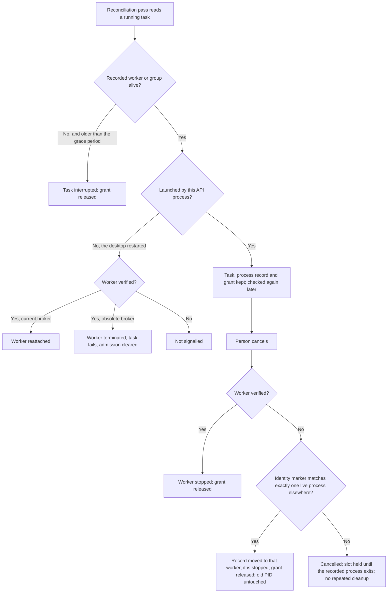

# Business workflow: recover or cancel a session task whose worker may still run

## Scope and starting conditions

A session task runs in a detached worker process. The desktop API process
that launched it owns it and holds its admission grant, the workspace slot it
runs in. This document covers what recovery and the task queue do with a task
whose recorded worker may still be alive: on the owner's own reconciliation
passes, after the desktop restarts, and after the person cancels the task.

It does not cover workflow step recovery decisions or Team build recovery,
which has [its own flow](team-build-recovery.md). It records behavior
implemented in the architecture-audit checkpoint, not a proposal.

## Flow

## Alternative flows

- A worker's process group can outlive its leader. The task is kept while any
  member runs.
- After a restart, a verified worker whose task had not started running, and an
  unverified group whose recorded leader is dead, are also terminated before
  the task is recovered.
- While a live process whose identity cannot be verified holds a task's record,
  the workspace starts nothing new (`dispatch_blocked`,
  `ambiguous_process_identity`) until that process exits or cleanup recovers
  the real worker.

## Business rules and test mapping

| ID | Required outcome | Test boundary and reason | Test file and exact name, or gap |
| --- | --- | --- | --- |
| RC-01 | The owner never interrupts its own task while the recorded worker or group is alive, even when its identity cannot be confirmed and however long it runs. Task, pid, group, identity and grant are kept. | Integration with a real child process and a fixed clock. | `tests/integration/owned-task-live-worker-recovery.test.ts`, "owner reconciliation keeps its live worker running with its grant when identity is unconfirmed" and "owner reconciliation never interrupts a live worker whose identity stays unconfirmed, however long it runs"; `tests/integration/session-task-process-lifecycle.test.ts`, "same-owner reconciliation keeps a task whose live pid carries another process identity" |
| RC-02 | A worker that has exited is reconciled as interrupted, and its grant is cleared, once the existing grace period has passed. | Same. | `tests/integration/owned-task-live-worker-recovery.test.ts`, "owner reconciliation still interrupts a task whose worker has exited and clears its grant" |
| RC-03 | A task whose process group outlives its exited leader is kept. | Integration with a real process group. Written after the fix, as a characterization test. | `tests/integration/owned-task-live-worker-recovery.test.ts`, "owner reconciliation keeps a task whose group outlives its exited leader" |
| RC-04 | The owner does not send its own live, verified worker to broker reconciliation on every pass. | Integration at the queue, with a substituted launcher; observed through `task_queue.reconciled` events. Its Red was run instrumented but unfixed. | `tests/integration/task-queue-provider-broker-reconciliation.test.ts`, "the owner does not reconcile its own live worker on every pass after the first provider connection" |
| RC-05 | After a restart, a live worker bound to the previous broker is terminated, its task fails with the obsolete-broker error, and its admission is cleared. | Same. | `tests/integration/task-queue-provider-broker-reconciliation.test.ts`, "a restarted owner still terminates a live worker bound to the previous broker" |
| RC-06 | A cancelled task whose live process cannot be verified is not sent to cleanup on every pass. It keeps its slot, and a later pass frees the slot once the process exits. | Integration at the queue with real processes. Its Red was run instrumented but unfixed. | `tests/integration/task-queue-cancelled-process-reconciliation.test.ts`, "the queue does not keep asking to clean up a cancelled task whose live process it cannot verify" |
| RC-07 | A cancelled task whose live worker is verified is stopped and released. | Same. | `tests/integration/task-queue-cancelled-process-reconciliation.test.ts`, "the queue still terminates and releases a cancelled task whose live worker it can verify" |
| RC-08 | When a cancelled task's identity marker matches exactly one live process away from a reused recorded pid, cleanup moves the record there, stops that worker, releases the grant, and leaves the process at the old pid running. | Same. | `tests/integration/task-queue-cancelled-process-reconciliation.test.ts`, "the queue still cleans up a cancelled task whose worker is found by identity away from a reused recorded pid" |

## Coverage boundaries

Test mappings describe intended coverage; run the relevant checks against the current checkout.

The queue tests substitute the task launcher and do not prove desktop startup or a first provider connection. A cancelled task with an ambiguous process marker may still be sent to cleanup repeatedly. An unverified live process can hold a task slot until it exits.
