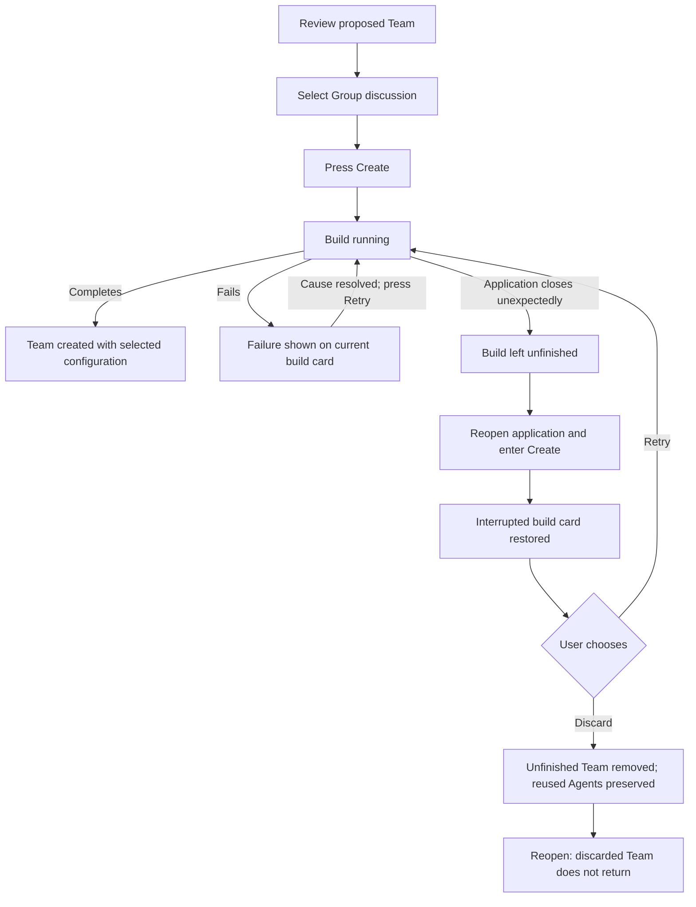

# Business workflow: create a Team and recover an unfinished build

## Scope and starting conditions

The user is in Create, has received a Team proposal, and changes its execution
configuration from a chain to Group discussion before pressing Create.

This worked example records existing recovery expectations from the tests linked
below. It is not a complete specification of Team creation. The tests were inspected,
not run, for this document on 2026-09-27.

The reopen paths assume this build is the newest build considered for restoration.
A newer terminal or discarded build prevents an older interrupted build from
returning; this is part of TB-02, not an exception to ignore during testing.

## Flow diagram

Returning to "Build running" means retrying with the previously selected
configuration. It does not mean resetting the choice or generating a new proposal.
The successful branch provides context; the detailed mapping focuses on recovery.

## Normal flow

1. The user reviews the proposed Team and its Agents.
2. The user selects Group discussion.
3. The user presses Create and the application builds the Team.
4. Creation completes with the selected configuration.

## Alternative flows

### A. The application closes during creation

1. The build is still running when the application closes unexpectedly.
2. The user reopens the application and enters Create.
3. The unfinished build appears as interrupted, rather than completed.
4. The user presses Retry.
5. Creation completes with Group discussion preserved.

### B. Creation fails while the application remains open

1. Creation fails, for example because the plan references an Agent that is missing.
2. The current build card reports the failure and does not offer the unfinished
   Team as ready to open.
3. After the cause is resolved, the user presses Retry on that card.
4. Creation completes with the previously selected configuration.

A failed build is not automatically restored on reopening merely because it failed.
Retry from the current card and restoration after an application interruption
are separate behaviors. See TB-01 and TB-05.

### C. The user discards an interrupted build

1. The user reopens Create and sees the interrupted build.
2. The user presses Discard.
3. The unfinished Team and its Team registry entry are removed.
4. Agents reused from before the build remain available.
5. Retry and Discard are no longer offered for the discarded build.
6. Reopening does not bring that Team back.

## Business rules and test mapping

Each link points to an existing test declaration. The exact names identify the
tests even if line numbers move. All entries have status **located, not run** for
this documentation task.

| ID | Required outcome | Test boundary and reason | Existing test |
| --- | --- | --- | --- |
| TB-01 | Running, interrupted, and partially completed jobs are eligible for restoration; completed, failed, cancelled, and discarded jobs are not. | Unit: pure eligibility decision. | [resource-build-recovery.test.ts:40](../../tests/unit/resource-build-recovery.test.ts#L40), "running, interrupted, and partially completed jobs are recoverable while completed, failed, and cancelled ones are terminal"; [line 53](../../tests/unit/resource-build-recovery.test.ts#L53), "a discarded job is terminal whatever its status" |
| TB-02 | A newer terminal or discarded job prevents an older interrupted job from returning. | Unit: decision across multiple job descriptions. | [resource-build-recovery.test.ts:69](../../tests/unit/resource-build-recovery.test.ts#L69), "a newer terminal or discarded job blocks restoring an older interrupted job" |
| TB-03 | Backend restart preserves the unfinished Team's identity without reporting it as a completed, selected resource. | Integration: actual API and saved records. | [resource-architect-creation.test.ts:702](../../tests/integration/resource-architect-creation.test.ts#L702), "a restarted API keeps an interrupted Team shell identified but unfinished" |
| TB-04 | Reopen and retry completes the interrupted build with Group discussion preserved. | Electron: UI selection, process termination, persistence, reopening, and retry. | [team-build-recovery-journey.spec.ts:579](../../tests/electron/team-build-recovery-journey.spec.ts#L579), "a build killed while it was still working is recovered and retried to publication" |
| TB-05 | Failure is retryable from its current card, preserves the selected configuration on completion, and does not offer an unfinished Team as ready to open. | Electron: visible failure controls and the result of using Retry. | [team-build-recovery-journey.spec.ts:726](../../tests/electron/team-build-recovery-journey.spec.ts#L726), "a build that failed is retried from its card, before leaving Create, through to a usable team" |
| TB-06 | Discard removes the unfinished Team, preserves reused Agents, removes retry controls, and survives reopening. | Electron: visible controls, filesystem effects, and a second launch. | [team-build-recovery-journey.spec.ts:782](../../tests/electron/team-build-recovery-journey.spec.ts#L782), "a build that stopped can be thrown away instead, and its team is gone" |

## Coverage boundaries

- Full Agent package authoring shares the ten-minute model-request budget across
  its draft and JSON repair, while Stop still cancels it. A silent Codex turn
  may legitimately finish after two minutes; silence alone at that point must
  not reject its draft. Covered by `tests/unit/agent-generation-timeout.test.ts`
  (145-second silence, repair, and the bounded failure case).
- An existing-Team update publishes only after all requested Agents are ready.
  If one fails, successful private packages remain reserved for retry and the
  Team stays unchanged. A remaining generation event in a terminal failed or
  interrupted update must display as interrupted, including jobs saved by older
  versions. Coverage: `tests/integration/resource-architect-update-batch.test.ts`,
  “a failed generation releases its own name and leaves the staged one reserved,”
  and `ui/src/components/create/agents-and-teams/__tests__/resource-update-card.test.tsx`,
  “stops showing an Agent as generating when its Team update has failed.”

Test mappings describe intended coverage; run the relevant checks against the current checkout.
