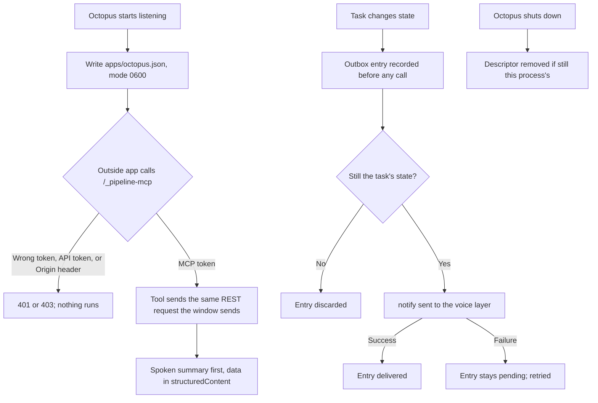

# Business workflow: voice control through MCP

## Scope and starting conditions

With multiple desktop windows, `show` prefers the view already displaying the
requested session, then the most recently focused live chat view. Canvas-only
windows are excluded; if only Canvas windows remain, `show` creates a chat
view. The routing rule is covered by `tests/unit/app-windows.test.ts`,
"voice navigation chooses a chat view or creates one instead of targeting a Canvas-only window".
Session changes
refresh all views without focusing them. See [multi-window routing](multi-window.md)
and `tests/electron/multi-window-voice.spec.ts`.

An outside app, normally the Hexa Puffs voice layer, finds Octopus, calls its
tools, and is told when work needs attention. Octopus runs as the desktop app
with voice control configured (`ApiServerOptions.voiceControl`). This document
covers the Octopus side. Enrollment, spoken confirmation and speech belong to
the voice layer ([feature document](../feature-voice-control-mcp.md)).

An external `ask` refreshes the already-open session when response activity
starts and when the answer is saved. Opening that session during generation
discovers its live turn and subscribes to the preview. `start_dialogue` refreshes
the session on admission. These updates neither select a different chat nor
bring the window forward. Explicit `show` retains its navigation behavior.

## Flow

## Business rules and test mapping

| ID | Required outcome | Test boundary and reason | Test file and exact name, or gap |
| --- | --- | --- | --- |
| VC-01 | A client that reads the descriptor can call the tools | Integration: real server, real SDK client | `tests/integration/voice-control-mcp-endpoint.test.ts`, "an MCP client that reads the descriptor lists the workflows from the registry" |
| VC-02 | The MCP path refuses a wrong token, the API token, and any Origin header | Integration: HTTP boundary | Same file: "the MCP path refuses a wrong token with 401", "the MCP path refuses the API token", "the MCP path refuses a request with an Origin header" |
| VC-03 | The MCP token opens no REST route | Integration: HTTP boundary | Same file: "the MCP token is refused on REST routes" |
| VC-04 | The descriptor is mode 0600 and removed at shutdown, but never another copy's | Integration and unit: file system | Same file: "the descriptor is private while the server runs and gone after shutdown"; `tests/unit/voice-control-discovery-files.test.ts`, "shutdown leaves a descriptor that a later copy of the app wrote" |
| VC-05 | Descriptors and tool shapes match `voice-control/1`, loopback only | Unit: schemas | `tests/unit/voice-control-contract.test.ts` |
| VC-06 | Catalog tools name what the window lists | Integration | Same endpoint file: "list_teams and list_agents name what the window lists", "list_sessions includes a chat created in the window" |
| VC-07 | Starting work answers at once with a task, and the task's later state is readable | Integration: fake worker writes `done` through its own store | Same endpoint file: "start_workflow returns a task at once, and get_task later reports done", "create_session makes a chat that start_workflow can use", "start_team starts the named team on a brief", "list_tasks names the tasks in a chat" |
| VC-08 | Cancelling is marked destructive and cancels the task | Integration | Same file: "cancel_task cancels the task and is marked destructive" |
| VC-09 | A route's refusal comes back as a spoken error | Integration | Same file: "a refusal from the route comes back as a spoken error, not a crash" |
| VC-10 | Session and task IDs that are not UUIDs are refused before any request, so no tool can address a route outside `/sessions` | Integration | Same file: "session and task IDs that are not UUIDs are refused before any request is made" |
| VC-11 | `ask` reports progress while the answer is written and returns the answer first | Integration: held model at the network boundary, released piece by piece on observed progress | `tests/integration/voice-control-ask.test.ts`, "ask returns the agent answer after progress notifications while it is written" |
| VC-12 | A client's total deadline cancels the call and the turn abandons its model request | Integration | Same file: "a call whose deadline signal fires is cancelled and the agent turn stops" |
| VC-13 | Results are listed, and `read_result` speaks the opening of an agent answer or a workflow report | Integration | Same file: "list_results offers an agent answer and read_result reads it aloud", "read_result reads a finished workflow report by its task" |
| VC-14 | Only text reports at a well-formed location are read aloud, at most 256 KB is read, and only the opening 2,000 characters are scanned for the spoken part | Integration and unit | `tests/integration/voice-control-ask.test.ts`, "read_result refuses a result that is not a text file"; `tests/unit/voice-control-spoken-text.test.ts`, "only the opening of a long text is considered, so the spoken part stays short" |
| VC-15 | A task waiting for feedback, an agent's answer or a model choice is read aloud by `get_question`, and continues after `answer_question` or `choose_model` | Integration: waits seeded through the worker's stores | `tests/integration/voice-control-answer.test.ts`, all four tests |
| VC-16 | A task that starts working is shown, and one that finishes is announced once with `read_result` and `show` follow-ups, and not again after a restart | Integration: a stand-in voice layer at the network boundary | `tests/integration/voice-control-attention.test.ts`, "the voice layer hears a task start working and finish once, and not again after a restart" |
| VC-17 | A change while the voice layer is away is announced once it is back, even across a restart | Integration | Same file: "a task that finished while the voice layer was away is announced once it is back, after a restart" |
| VC-18 | A notify whose reply is lost is resent with the same `dedupeKey`, and stops once acknowledged | Integration | Same file: "a notify whose reply is lost is sent again with the same dedupeKey, and then not again" |
| VC-19 | A question answered while the voice layer is away is not asked later; an open one is asked urgently | Integration | Same file: "a question answered in the window while the voice layer was away is not asked when it returns", "a question that is still open when the voice layer connects is asked, urgently" |
| VC-20 | Octopus reaches the voice layer only through a live, loopback descriptor and its own grant | Unit | `tests/unit/voice-control-discovery-files.test.ts`, the four `readVoiceLayerEndpoint` tests |
| VC-21 | A caller's `onprogress` receives progress through the client manager | Integration | `tests/integration/mcp-client-manager-progress.test.ts` |
| VC-22 | `show` opens an existing session in the window, refuses an unknown one without touching the window, and says so when there is no window | Integration: the window function is the boundary | `tests/integration/voice-control-show.test.ts`, all three tests |
| VC-23 | A voice layer's `show` brings the desktop forward with that chat open | Electron journey, headless and visible-window runs | `tests/electron/voice-control-show.spec.ts`, "a voice layer opens a chat in Octopus with show" |
| VC-24 | The renderer opens only a session named by a valid ID, and unsubscribes on unmount | UI hook test | `ui/src/hooks/__tests__/use-voice-navigation.test.tsx` |
| VC-25 | Desktop journeys use their own temporary voice-control discovery folder, overriding the host's folder even without the test-run flag | Integration on the journey environment; real Electron dialogue/navigation journeys use that isolated folder | `tests/integration/desktop-journey-environment.test.ts`, "a desktop journey advertises voice control only in its temporary folder" |
| VC-26 | A question that cannot be checked for a while stays pending and is asked once the check succeeds; only a question proven answered or replaced is dropped | Integration: Octopus's question route answers 500 for a while at the HTTP boundary | `tests/integration/voice-control-attention.test.ts`, "a question whose lookup fails for a while is still asked once the lookup recovers" |
| VC-27 | A task's ending is announced only for the attempt that ended that way | Integration across restarts with the voice layer away | Same file: "an earlier attempt's ending is not announced once a later attempt has ended the same way" |
| VC-28 | The longest question an agent may ask is announced within the spoken limit, and one entry the contract refuses never stops the outbox from being saved | Integration and unit | Same file: "the longest question an agent may ask is announced, within the spoken limit"; `tests/unit/voice-control-notification-outbox.test.ts` |
| VC-29 | A running task's status names what its run is doing, from the worker's own events | Integration: events written with the worker's log functions | `tests/integration/voice-control-attention.test.ts`, "a working task is shown with what it is doing, from its run events" |
| VC-30 | Connecting starts no dialogue; an explicit MCP start defaults to text and creates a normal chat, and controls reach that same saved dialogue | Integration: authenticated SDK, real REST services and stores, provider replaced at HTTP | `tests/integration/agent-dialogue-mcp.test.ts`, both journeys |
| VC-31 | Dialogue speech uses the app's grant, forwards validated progress, refuses another utterance's receipt, and sends cancellation to the voice layer | Integration: real SDK against a loopback voice server | `tests/integration/voice-layer-say.test.ts`, all five cases |
| VC-32 | A stalled loopback request has a bounded deadline | Integration: real held HTTP response | `tests/integration/voice-control-rest-deadline.test.ts` |
| VC-33 | The configured discovery folder and its enrollment grants cannot be attached or read through shared-folder tools, including beneath an attached parent | Integration: real REST admission, dialogue provider tool loop and temporary credentials | `tests/integration/voice-control-folder-protection.test.ts`, both cases; 2/2 Green on 2026-10-10 after behavioral Red; omission of the discovery root failed the tool-loop mutation check |
| VC-34 | Dialogue generation activity clears on Pause or Stop even when no speech begins; stale cleanup preserves a newer label | Integration: real Octopus API/MCP; Hexa Puffs SDK and Electron | `tests/integration/agent-dialogue-voice-status.test.ts`, both cases; Hexa Puffs's `tests/e2e/octopus-status.spec.ts` and status SDK cases |
| VC-35 | An external `ask` displays its saved answer in the already-open chat without `show`, navigation or focus changes | Electron: real SDK, preload, renderer and filesystem; provider replaced at HTTP | `tests/electron/voice-control-external-chat.spec.ts`, "an external agent answer appears in the already open chat without show or navigation"; behavioral Red reproduced on 2026-10-10 |
| VC-36 | An external dialogue displays its controls and replies in the already-open chat without `show`; unrelated or invalid refresh events are ignored and listeners are removed on unmount | Electron plus UI event-boundary tests | `tests/electron/agent-dialogue-voice.spec.ts`, "an external dialogue refreshes the session that is already open without show"; `ui/src/hooks/__tests__/use-voice-session-refresh.test.tsx`; behavioral Red reproduced on 2026-10-10 |
| VC-37 | Refused Agent IDs or unusable provider options leave no new chat. Known admission failures atomically remove only blank new chats, preserving caller-supplied chats, claims and saved work. | Real SDK/REST and filesystem | `tests/integration/agent-dialogue-mcp.test.ts`, refused-call cases; `tests/integration/voice-control-refused-session-retention.test.ts` protects a writer immediately before rollback deletion; `tests/integration/session-empty-rollback.test.ts` protects claims, transcript bytes, attachments, tasks and other work |
| VC-38 | The delivered `ask` catalog states its actual two-minute limit and names the asynchronous workflow alternative | Real SDK catalog | `tests/integration/agent-dialogue-mcp.test.ts`, "ask advertises its actual two-minute limit and tells callers how to request long work" |
| VC-39 | Publishing a descriptor tightens an existing `apps/` directory to owner-only access | Real temporary filesystem | `tests/unit/voice-control-discovery-files.test.ts`, "writing a descriptor tightens an existing apps folder to owner-only access" |
| VC-40 | A new voice question receives the same context-derived title as a manually started chat; explicit existing titles are preserved | Electron, real MCP and title service with the provider replaced at HTTP | `tests/electron/voice-control-external-chat.spec.ts`, "a new voice chat gets a generated title from the question" and the existing named-chat journey |
| VC-41 | Opening a voice chat while its answer is running shows response activity, subscribes to its preview and replaces it with the saved answer when finished; optional titling does not keep a saved answer active | Integration for live turn discovery; Electron for opening the chat and terminal display | `tests/integration/voice-control-ask.test.ts`, "opening a voice chat reports its live turn until the answer is saved"; `tests/integration/agent-chat-stream-sse.test.ts`, "a saved answer stops appearing active while its channel remains open for titling"; `tests/electron/voice-control-external-chat.spec.ts`, "opening a voice chat during generation shows thinking and then the saved answer" |

## Coverage boundaries

Test mappings describe intended coverage; run the relevant checks against the current checkout.

Local transport and provider fixtures do not establish physical microphone, audible playback or installed-package behavior.
