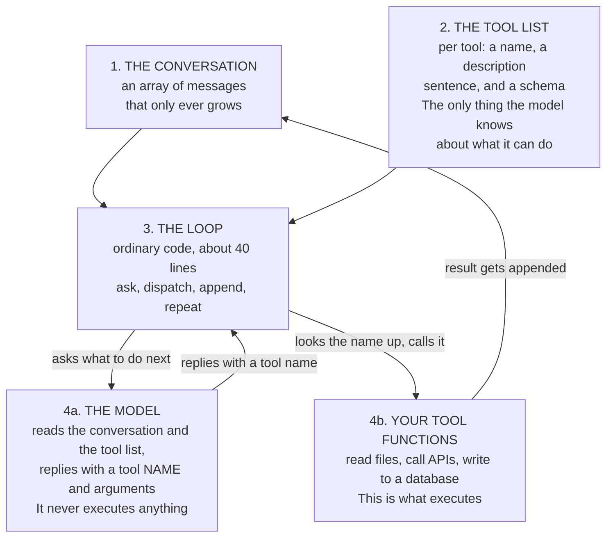
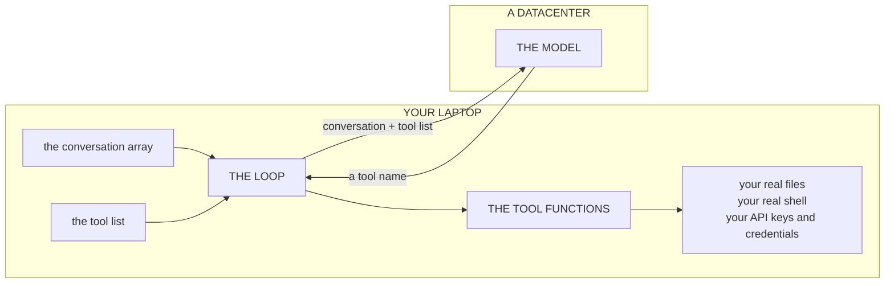
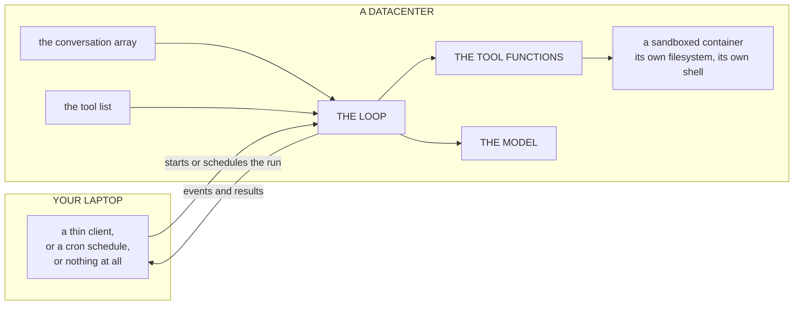

# Task Brief

Workflow: `team-chat-teaching-team-ccd2c2952aa0`

## User Brief

# Current user message

can you edit these files actually?

# Conversation continuity

Previous responders: teaching-pedagogy-specialist, subject-matter-technical-reviewer, editor

Recent Team conversation:
Previous user message: # Task Brief

Workflow: `team-chat-teaching-team-ccd2c2952aa0`

## User Brief

# Current user message

have a look at these files. it supposed to be a class about cli. a short one. i am not happy with how it is written. let me know what you think guys and propose corrections.

# Conversation continuity

Previous responders: none

Use this history as a soft continuity signal. Keep prior responders only when their expertise remains relevant, and add or replace specialists when the current message requires it.
The current user message is authoritative. Any valid @agent mention in it must be selected.

## Uploaded File Context

### 01-introduction.md

- Parse status: parsed

---
source: "01-introduction.md"
type: "generic"
original_format: "md"
total_chars: 7963
---

# 01-introduction.md

# Introduction

## What a CLI is

CLI stands for command line interface. It is a program you operate by typing its
name and some words, instead of by clicking things.

The mechanism underneath is smaller than almost everyone expects:

> A CLI is a program that receives the words you typed as an array of strings,
> and prints text back.

That is the whole thing. `git`, `npm`, `docker`, `ffmpeg` and `cl
- teaching-pedagogy-specialist: I'll proceed with structured pedagogical analysis using the learning-science framework in my instructions.

---

## PEDAGOGICAL ASSESSMENT: CLI Tutorial

### 1. LEARNING OBJECTIVES — Critical Issues

**Finding: Learning objectives are present but improperly sequenced and lack prerequisite clarity.**

The README states outcomes for each class ("By the end you can..."), which is good. However:

- **Objectives are buried in class descriptions.** An introductory chapter should state learning outcomes *before* content, not embedded in a feature list. Learners don't know what they're aiming for when they read 01-introduction.md.
- **No explicit prerequisite validation.** The materials assume learners already know: JavaScript/Node, terminal basics, array concepts, basic functions. These are mentioned in passing ("Node v18+") but never scaffolded or pre-checked. A learner without JavaScript will hit Class 2 and fail silently.
- **Vague foundational objective:** "Turn any script into a command" (Class 1) is not measurable enough. What does "turn into a command" mean? Does the learner type it three times and it works? Pass a test? The success criterion is invisible.

**Example of a clear obj
- subject-matter-technical-reviewer: ## SUBJECT MATTER VERDICT

---

### Overall Accuracy

**TECHNICALLY CORRECT.** All major factual claims—about CLI mechanism, agent architecture, platform-specific behavior, and tool recommendations—are accurate and current as of February 2025. No factual errors or unsupported claims detected. The materials accurately represent how CLIs work, how agents are built, and current professional practice.

---

### Factual Claims Verified

**CLI Mechanism**
- Claim: "A CLI is a program that receives the words you typed as an array of strings, and prints text back." ✓ Accurate. Operating systems do pass arguments as arrays to program entry points.
- Claim: Everything about CLIs is convention, not enforced by the OS. ✓ Accurate. Subcommands, flags, --help, exit codes are all programmer-implemented patterns.

**Agent Architecture**
- Claim: An agent has four parts (conversation array, tool list, loop, model). ✓ Accurate. This decomposition matches how Claude tool use, OpenAI function calling, and other modern agents actually work.
- Claim: "The model never executes anything. Your code does every actual call." ✓ Correct and critical. The model returns text (tool name + args); execution happens
- editor: <review_decision>REVISE</review_decision>

# Editorial Review: CLI Tutorial Materials

**Date:** 2026-09-05  
**Session:** d49e6a17-ad1a-4108-a97e-c1bcbe5fd83b  
**Verdict:** REVISION

## Review Summary

- **Brief compliance:** Partial  
- **Structural logic:** Weak for the stated purpose  
- **Clarity:** Strong sentence-level writing, but overlong and over-scoped  
- **Style compliance:** Engaging, direct, opinionated; sometimes too expansive  
- **Consistency:** Mostly consistent, with sequencing contradictions

## Issue Counts

| Severity | Count |
| -------- | ----- |
| BLOCKING | 4 |
| WARNING | 5 |
| SUGGESTION | 3 |

## BLOCKING Issues

### 1. The material is not “a short class about CLI”; it has become a CLI-plus-agents mini-course
- **Layer:** Brief compliance  
- **Location:** README title, “Understanding CLIs, and how agents get exposed through them”; `02-how-agents-work.md`; README “Class 4: Agents”
- **Problem:** The user expected a short class about CLI. The current package is a five-class course with a large agent architecture component. `02-how-agents-work.md` alone is almost 10k characters and is not primarily about CLIs.
- **Impact:** The reader’s expectation and 
- teaching-team-lead: Specialists identified converging problems (scope drift, cognitive overload, sequencing issues) but have not yet reconciled conflicting recommendations. Editor recommends reframing the entire package (CLI-first, agents optional). Pedagogy recommends reordering within current structure. This tension requires specialist reconciliation to determine if both fixes are needed or if one addresses the root cause. Second pass will produce integrated recommendations rather than requiring teaching-team-lead to resolve specialist disagreements.

Round 2: Reconciliation review. Read all three Round 1 reviews. Then revise your recommendations by answering: (1) Which specialist perspective identifies the root problem? (2) Do your recommendations conflict with the other specialists' or integrate with them? (3) If we implement both pedagogy's reordering AND editor's scope reframing, do they work together or fight each other? Propose how your recommendations should change in light of the other two specialist perspectives.
- teaching-pedagogy-specialist: # RECONCILIATION REVIEW: Round 2

## Threshold Finding

All three specialists identified the **same root problem**, expressed through different lenses. The scope has drifted from "short CLI class" to "full CLI + agent architecture course," which simultaneously violates the user's brief, pedagogical sequencing principles, and prerequisite validation. The solutions proposed by each specialist integrate perfectly rather than conflict.

---

## (1) Which Specialist Identified the Root Problem?

**The Editor articulated it most directly; all three identified it in different layers.**

| Specialist | Finding | Domain |
|---|---|---|
| **Editor** | "The material is not 'a short class about CLI'; it has become a CLI-plus-agents mini-course" | Brief compliance |
| **Pedagogy** | "Agents introduced before learners build a CLI, violating prerequisite structure and cognitive load principles" | Learning science |
| **Technical** | "Prerequisite knowledge assumed but not validated" (because scope is unclear) | Accuracy & assumptions |

**Root diagnosis:** The scope crisis cascades into pedagogical problems (sequencing violation) and technical problems (unvalidated prerequisites). Fixing the scop
- subject-matter-technical-reviewer: # RECONCILIATION REVIEW: Subject Matter & Technical Perspective

---

## (1) Which Specialist Identified the Root Problem?

**The Editor identified it first and most directly; Pedagogy confirmed it through learning-science analysis; I underweighted it in Round 1.**

| Specialist | Finding | Validity |
|---|---|---|
| **Editor** | "Not 'a short class'—it's become a full CLI + agents mini-course" | Direct brief analysis; correct |
| **Pedagogy** | "Scope drift cascades into sequencing violations and prerequisite assumption problems" | Learning-science framing; correct diagnosis of downstream effects |
| **Technical (me)** | "Prerequisite knowledge assumed but not validated" | Correct observation, but *derivative* of scope problem, not independent |

**Root cause:** I flagged a symptom (unvalidated prerequisites), not the disease (scope ambiguity). The Editor's scope reframing removes that symptom as a side effect.

---

## (2) Do My Recommendations Conflict with the Others?

**No conflicts. My Round 1 recommendations were narrow and orthogonal to both.**

| My Rec | Conflicts with Editor? | Conflicts with Pedagogy? | Integration |
|---|---|---|---|
| "All factual claims accurate" | N
- editor: <review_decision>APPROVE</review_decision>

# Editorial Review: Round 2 Reconciliation Position

**Date:** 2026-09-05  
**Session:** d49e6a17-ad1a-4108-a97e-c1bcbe5fd83b  
**Verdict:** APPROVED

## Review Summary

- **Brief compliance:** Pass  
- **Structural logic:** Strong  
- **Clarity:** Clean  
- **Style compliance:** Aligned  
- **Consistency:** Consistent  

## Issue Counts

| Severity | Count |
| -------- | ----- |
| BLOCKING | 0 |
| WARNING | 0 |
| SUGGESTION | 1 |

## Position

The three reviews now converge cleanly.

### 1. Which specialist perspective identifies the root problem?

The **editorial perspective** identifies the root problem most directly: the material does not match the user’s stated need for “a short class about CLI.” It has expanded into a broader CLI-plus-agent mini-course.

The pedagogy review explains why that scope drift harms learning: abstract agent architecture arrives before learners have built enough concrete CLI experience. The technical review confirms the content is accurate, but also shows that accuracy is not the blocker. The problem is not correctness; it is scope and sequencing.

### 2. Do my recommendations conflict with the other specia
- teaching-team-lead: ## Teaching Manual Review: Unified Improvement Roadmap

**Manual Type:** Hands-on tutorial; intended as short CLI mechanics class with optional agent architecture extension  
**Core Finding:** Scope has drifted from "short CLI class" to "full CLI + agents mini-course." This creates cascading failures: brief misalignment (editorial), pedagogical sequencing violation (learning science), and silent prerequisite assumptions (technical). Root cause is scope ambiguity, not inaccuracy.

---

### THE PROBLEM (All Three Specialists Aligned)

**Scope Drift:** Material promises "short class about CLI" but delivers a 5-class course with heavy agent architecture content front-loaded into the introduction.

**Consequences:**
- **Editorial:** User's brief not met. Expected 1–2 hour class; material is 3.5+ hour course.
- **Pedagogical:** Agent architecture (abstract, conceptual) arrives before learners build CLI foundations (concrete, hands-on). Violates scaffolding principle: concrete → abstract, not reverse.
- **Technical:** Prerequisite assumptions are hidden. Without scope clarity, learners may proceed unprepared; silent failure risk.

**Evidence:** 
- 01-introduction.md jumps from "a CLI rece

Use this history as a soft continuity signal. Keep prior responders only when their expertise remains relevant, and add or replace specialists when the current message requires it.
The current user message is authoritative. Any valid @agent mention in it must be selected.

## Uploaded File Context

### 01-introduction.md

- Parse status: parsed

---
source: "01-introduction.md"
type: "generic"
original_format: "md"
total_chars: 7963
---

# 01-introduction.md

# Introduction

## What a CLI is

CLI stands for command line interface. It is a program you operate by typing its
name and some words, instead of by clicking things.

The mechanism underneath is smaller than almost everyone expects:

> A CLI is a program that receives the words you typed as an array of strings,
> and prints text back.

That is the whole thing. `git`, `npm`, `docker`, `ffmpeg` and `claude` are all
doing exactly that. When you type:

```bash
git commit -m "fix login"
```

the operating system starts a program called `git` and hands it a list of four
strings: `["commit", "-m", "fix login"]`. Everything `git` does next is ordinary
code reading an ordinary array. There is no special command line layer, no
parser provided by the system, no framework doing work on your behalf.

I want to be blunt about this because it is the single most useful thing in the
tutorial. Everything you associate with a CLI is convention that people agreed
on and then write out by hand, over and over, in every tool ever shipped.
Subcommands. Flags starting with a dash. `--help`. Exit codes. Pipes. None of it
is enforced by anything. It is habit, all the way down.

That is good news. It means this is a small subject you can actually finish,
which is why the tutorial is five short classes and not a forty-hour course.

## Why this is worth an afternoon

The main [README](README.md) makes the practical case: agents live in the
terminal, a CLI is an agent tool for free, and the design pattern transfers
directly to agent tools. I will not repeat all of that here.

What I want to add is the thing that took me longest to appreciate.

**Learning CLIs teaches you to think in verbs and nouns.** A good CLI forces you
to answer questions you can otherwise avoid: What are the actual operations
here? Which are the same operation with a different setting, and which are
genuinely different? What is the shortest honest name for this thing? What
should happen when it fails?

You cannot dodge those questions in a CLI. There is no room. You have a word and
some flags, and if your model of the problem is muddy, the interface comes out
muddy in a way that is immediately obvious to anyone who tries to use it.

That is a design skill, not a terminal skill, and it transfers everywhere. It is
why people who write good CLIs tend to write good APIs, good function
signatures, and, as it turns out, good tool definitions for AI agents. The
constraint is the teacher.

## How agents fit in

This is what the tutorial builds toward, so here it is in full, up front.

A normal CLI has a **dispatch table**. Somewhere in the code there is a `switch`
statement, and the first word you typed selects which function runs:

```
you type "notes add milk"   ->   switch   ->   addNote() runs
```

An agent CLI is the same program with one thing replaced. Instead of the word
you typed selecting the function, a language model selects it:

```
you type "remind me to buy milk"   ->   a model   ->   addNote() runs
```

To make that work, you hand the model a list of your functions. Each one gets a
name, a sentence describing when to use it, and a description of what arguments
it takes. The model reads your sentences, picks one, and replies with a function
name and some arguments. Your code looks up that name and calls the function.
Then you hand the result back and ask again, until the model stops asking for
functions and just answers you.

That is an agent. Not a metaphor for one, not a simplified version. Class 4 is
about 40 lines of ordinary JavaScript and it is the real thing.

The next chapter, [02-how-agents-work.md](02-how-agents-work.md), draws this out
properly: the four parts an agent has, what one turn looks like step by step, and
where each piece actually runs when the agent is on your laptop versus in the
cloud. Read it before class 4 and the code will arrive as confirmation rather
than as new material.

Three consequences surprise people, and all three are worth carrying with you.

**The model never executes anything.** It receives text and returns text: a
function name and some arguments, as data. Your code does every actual call.
That gap is not an implementation detail, it is the security model. It is where
permission prompts live in tools like Claude Code, and it is why an agent can
only ever do things you wrote a tool for. When you read a headline about an
agent "going rogue", what actually happened is that somebody gave it a tool that
could do that and did not gate it.

**The conversation is just an array you append to.** Ask, get a tool name, run
it, append the result, ask again. No hidden state, no memory, no magic. Class 4
has a `--verbose` flag that prints the array after every turn so you can watch
the whole thing happen.

**The descriptions are the program.** This is the part that feels wrong to
engineers and is the most important thing in class 4. The sentence you write to
describe a tool is not documentation. It is the code that decides whether that
tool gets picked. A vague description is a bug, and you fix it by writing more
clearly, not by writing more code. Building good agents is a surprising amount
of editing prose.

## Why the tutorial is shaped this way

Two deliberate choices, so you know what to look for.

**Classes 2 and 4 are the same program twice.** Class 2 builds a small notes app
where you type commands. Class 4 puts a model in front of the identical logic.
The point is the diff between them. If you work through class 4 without having
built class 2 yourself, you will learn the syntax of tool definitions but miss
the actual insight, which is how little changed.

**Nothing uses a library.** No argument parser, no agent framework. This is
slower, and it is on purpose. Frameworks are good, and you should use them at
work. But if a framework is the first thing you meet, you cannot tell where the
framework ends and the subject begins, and you end up memorising an API instead
of understanding a domain. Write it by hand once, then reach for
[commander](https://github.com/tj/commander.js) or
[typer](https://typer.tiangolo.com) forever after, knowing exactly what they are doing for you.

## What is actually hard about this

Not the code. Genuinely. Argument parsing is `if` statements and array
filtering, and you will find class 2 easy.

The hard parts, in rough order:

1. **Naming.** Choosing verbs that are obvious to someone who is not you.
2. **Deciding what is a subcommand and what is a flag.** There is a real
   principle here and [clig.dev](https://clig.dev) explains it well.
3. **Error messages.** Saying what went wrong and what to do about it, rather
   than dumping a stack trace.
4. **Knowing where your output is going.** Class 3. Almost everybody gets this
   wrong at least once, silently.

All four of those are also the hard parts of designing agent tools, which is not
a coincidence. It is the same skill wearing a different hat.

## What this tutorial is not

It is not a course on shell scripting, bash, or living in the terminal. Related,
but a different subject, and the Missing Semester lectures in
[04-further-reading.md](04-further-reading.md) cover it far better than I could.

It is also not a survey of CLI frameworks, for the reason given above.

## How to work through it

Do the classes in order. Each one has the same three parts: what it covers, what
you should be able to do afterwards, and exercises.

**Do the exercises.** I know. But reading a CLI tutorial without typing is close
to useless, because the whole subject is convention and muscle memory, and
neither of those arrive by reading. Several exercises deliberately ask you to
break something and watch what happens, which is faster than any explanation I
could write.

If you are short on time, the minimum path is class 2 then class 4. But class 3
is only 30 minutes and it is the one that explains why any of this exists.

Next: [02-how-agents-work.md](02-how-agents-work.md)

### 02-how-agents-work.md

- Parse status: parsed

---
source: "02-how-agents-work.md"
type: "generic"
original_format: "md"
total_chars: 9903
---

# 02-how-agents-work.md

# How modern agents work

You will build one of these in class 4, in about 40 lines. This chapter is the
map you will be filling in, so that the code arrives as confirmation of
something you already understand rather than as a new thing to memorise.

It also answers a question people ask constantly and get wrong in a specific
way: what is the difference between an agent running on your laptop and one
running in the cloud?

## An agent is four parts

Strip away the branding and every agent, from a 40-line script to a commercial
product, is the same four things.



That is the entire inventory. If you can name those four parts and say what each
one holds, you can reason about any agent system you meet, including ones whose
documentation is trying hard to make it sound more complicated.

## One turn, in order

Here is a single exchange, start to finish. This is exactly what `--verbose`
prints in class 4.

```mermaid
sequenceDiagram
    autonumber
    actor You
    participant Loop as THE LOOP
    participant Tools as YOUR TOOL FUNCTIONS
    participant Model as THE MODEL

    Note over Loop,Tools: both of these are your own code
    You->>Loop: "mark 2 as done"
    Loop->>Model: conversation + tool list
    Note right of Model: reads your descriptions,<br/>picks one
    Model-->>Loop: call complete_note with id 2
    Loop->>Tools: complete_note(2)
    Note over Tools: runs HERE, in your code
    Tools-->>Loop: id 2, done true
    Loop->>Model: same conversation + the result
    Note right of Model: sees that it worked
    Model-->>Loop: "Marked note 2 as done."
    Loop-->>You: printed output
```

Two details in that diagram do most of the work.

**The model is asked twice.** Once to choose the tool, once to react to what the
tool returned. A three-tool task means four or five round trips, not one. This
is why agents are slower and more expensive than a single model call, and why
class 4 caps the loop at five turns.

**The tool runs in the middle, in your code.** The model said the words
`complete_note` and `2`. Your code looked that name up and called the function.
The model has no hands.

## Where the computation actually happens

Now the question this chapter exists for.

The common intuition is that local and cloud agents differ only in where the
computation happens. That is broadly right, and it is worth making precise,
because there are **three separate locations**, not one, and they can be mixed
independently.

| Piece | Can run on your machine? | Can run in a datacenter? |
|---|---|---|
| The model inference | Rarely | Almost always |
| The loop | Yes | Yes |
| The tool functions | Yes | Yes |

The misconception to kill first: **"local agent" does not mean the model runs
locally.** When you use Claude Code on your laptop, the model is not on your
laptop. Your conversation is sent over the network to a datacenter on every
single turn, and a tool name comes back. What is local is the loop and the
tools, which is a real and important distinction, just not the one the word
suggests.

The exception is genuinely local models, run with something like Ollama or
llama.cpp. Then inference is on your hardware too. That is a real option and a
different set of tradeoffs, and it is rare enough that it is worth naming as the
exception rather than the rule.

## Configuration A: the local agent

Claude Code, aider, and the `agent.js` you will build in class 4.



The boundary sits between the loop and the model. Everything except inference is
on your machine, which has consequences that follow directly:

- **The tools touch your actual files**, with your actual permissions. This is
  the point of a local agent and also its entire risk profile. It is why these
  tools ask before editing.
- **Your credentials never leave.** If a tool calls your company's database, the
  connection is from your machine using your credentials.
- **It stops when you close the laptop.** The loop is a process on your computer.
- **Only the conversation crosses the network.** Your prompts, your tool results,
  your file contents when a tool reads one. Not your whole disk.

## Configuration B: the cloud agent

Managed or hosted agents, where a provider runs the loop for you. Anthropic's
Managed Agents work this way.



The boundary moved. It did not change what the parts are, which is exactly the
intuition you had. But moving it changes what the agent can and cannot reach:

- **The tools touch a container, not your laptop.** There is no path from that
  sandbox to your filesystem. To let it work on your code, you upload or mount
  the code.
- **It runs when you are asleep.** Nothing depends on your machine being on,
  which is what makes scheduled agents possible at all.
- **Credentials have to get there.** This is the real work of cloud agents.
  Secrets need managing so a sandbox can use a credential without exposing it.
- **More of your data crosses the network**, because the files the agent works on
  have to be on the provider's side.

## Configuration C: mixtures

The boundary is not a switch with two positions. Common hybrids:

- **Cloud loop, local tools.** The provider runs the loop, but when the model
  asks for a tool your machine executes it and sends back the result. You get
  scheduling and hosting while keeping credentials at home.
- **Local loop, cloud tools.** A local agent whose tools run commands in a remote
  sandbox, so risky work is isolated from your filesystem.

Both are just the same four parts with the line drawn somewhere else.

## The comparison that matters

| | Local agent | Cloud agent |
|---|---|---|
| The model | In a datacenter | In a datacenter |
| The loop | Your machine | Provider's servers |
| Tools execute on | Your real filesystem | A sandboxed container |
| Runs with laptop closed | No | Yes |
| Can be scheduled | Only if your machine is on | Yes |
| Credentials live | On your machine | With the provider, in a secret store |
| Blast radius if a tool misbehaves | Your files | The container |
| Setup cost | Install and go | Config, mounts, secrets |
| Best for | Working on your own code, right now | Long jobs, scheduled work, shared infrastructure |

Notice that model quality is not on that list. It is the same model either way.
The choice is about **where your data sits, whose machine executes the work, and
whether it needs to run when you are away.** It is not a capability decision, and
people waste time treating it as one.

## Why the loop code does not change

This is the part worth carrying into class 4.

The `agent.js` you are going to write is the same 40 lines in every
configuration above. Local, cloud, hybrid. The loop asks something for a
decision, dispatches by name, appends a result, and goes again. It does not know
and does not care which machine answered, or which machine ran the tool.

You will prove this to yourself in class 4 without meaning to. The class ships
two models: `fake-model.js`, which is keyword matching running in your own
process, and `real-model.js`, which calls a datacenter. Swapping between them is
**one import line.** The loop is untouched, because the loop was never coupled to
where the answer came from.

That is the same lesson as class 2's split between `notes.js` and
`notes-core.js`, arriving from a different direction. Interfaces that only
describe what they need can have their other side replaced freely. It is why the
question "local or cloud" turns out to be an operational and security question
rather than an architectural one.

## What to take into the classes

- An agent is four parts: a conversation, a tool list, a loop, and a model,
  plus your functions.
- The model chooses; your code executes. Always, everywhere, in every product.
- Three locations can move independently: inference, loop, tools.
- "Local" almost never means the model is local.
- The parts do not change when the boundary moves. Only reach, latency, and
  who holds the secrets.

Next: [03-mac-vs-windows.md](03-mac-vs-windows.md), which is short and practical,
then [class-1](class-1/).

### 03-mac-vs-windows.md

- Parse status: parsed

---
source: "03-mac-vs-windows.md"
type: "generic"
original_format: "md"
total_chars: 5098
---

# 03-mac-vs-windows.md

# Mac versus Windows

The JavaScript in this tutorial is identical on both. What changes is how you
*start* it, and a handful of shell details in the example commands.

All examples in the class folders are written for macOS. If you are on Windows,
this page is your translation table. Read it once, then keep it open for
classes 1 and 3, which are the two that touch shell behaviour.

## The short version

On macOS you can run a script directly, like `./hello.js`.
On Windows you always put `node` in front, like `node hello.js`.

That single difference accounts for most of what follows.

## Why the difference exists

macOS and Linux support a **shebang**: if the first line of a file is
`#!/usr/bin/env node`, the operating system reads it and knows to launch the
file with Node. You mark the file executable with `chmod +x`, and after that
it behaves like any other command.

Windows has neither of those mechanisms. It decides how to open a file by its
extension, using file associations, and it has no executable bit at all. So the
shebang line in these files is simply ignored on Windows, and you name the
program yourself.

This is not a problem to solve. It is how Windows works, and class 5 shows how
npm papers over it when you install a CLI properly.

## Translation table

| What you want | macOS (zsh) | Windows PowerShell | Windows cmd |
|---|---|---|---|
| Run a script | `./hello.js` | `node hello.js` | `node hello.js` |
| Make it runnable | `chmod +x hello.js` | not needed | not needed |
| See the exit code | `echo $?` | `echo $LASTEXITCODE` | `echo %ERRORLEVEL%` |
| Set an env variable | `export KEY=value` | `$env:KEY="value"` | `set KEY=value` |
| Throw away stderr | `2>/dev/null` | `2>$null` | `2>nul` |
| Current folder | `./` | `.\` or `./` | `.\` |

The pipe character is left out of that table on purpose, because a pipe inside a
markdown table cell is a fight nobody wins. It works identically on all three:

```bash
first-command | second-command
```

That is lucky, because class 3 is entirely about pipes.

## Worked examples from the classes

**Class 1**

```bash
# macOS
chmod +x hello.js
./hello.js Alex --loud

# Windows
node hello.js Alex --loud
```

**Class 2, checking an exit code**

```bash
# macOS
./notes.js bogus ; echo "exit code was $?"

# Windows PowerShell
node notes.js bogus ; echo "exit code was $LASTEXITCODE"
```

Note that PowerShell's `$?` is not the exit code. It is a true/false value
saying whether the last command succeeded. The actual number is in
`$LASTEXITCODE`. This trips up people moving from macOS constantly.

**Class 3, pipes**

```bash
# macOS
echo "hello there" | ./pipe.js --upper
../class-2/notes.js list --json | ./pipe.js --count 2>/dev/null

# Windows PowerShell
echo "hello there" | node pipe.js --upper
node ../class-2/notes.js list --json | node pipe.js --count 2>$null
```

**Class 4**

```bash
# macOS
./agent.js "add a note to call the dentist"

# Windows
node agent.js "add a note to call the dentist"
```

## Smaller differences worth knowing

**Quotes in `echo`.** In zsh and PowerShell, `echo "hi"` prints `hi`. In cmd it
prints `"hi"`, quotes included, because cmd does not strip them. If a class 3
example gives you output with stray quote marks, this is why. Use PowerShell.

**Path separators.** Windows uses `\`, macOS uses `/`. Node accepts `/` on both,
so the code here needs no changes. When you write your own tools, build paths
with Node's `path` module rather than gluing strings together, and it stays
portable for free.

**Line endings.** Windows uses CRLF, macOS uses LF. If you ever copy these files
into WSL or a Linux box and get `bad interpreter: no such file or directory`,
that is a CRLF line ending on the shebang. Set `git config --global
core.autocrlf input` to avoid it.

**PowerShell versus cmd.** Use PowerShell. Cmd is a much older shell with
quoting rules that will waste your time. PowerShell 7 or later handles piping
text to programs like Node cleanly. Windows PowerShell 5.1, the blue one that
ships in the box, has encoding quirks when piping to external programs.

## Should you just use WSL

If you plan to do more of this kind of work, yes, and it is worth the setup
afternoon. WSL gives you a real Linux environment inside Windows, so every
example in every tutorial you will ever read works verbatim, shebangs included.
Install it with `wsl --install` in an admin PowerShell.

If you only want to get through these five classes, do not bother. Putting
`node` in front of things is not hard, and the translation table above covers
everything you will hit.

## One thing that is identical

`npm link` in class 5 works the same on both. On macOS it creates a symlink; on
Windows npm generates small `.cmd` and `.ps1` wrapper files that call Node for
you. Either way you end up typing `notes` and it works. That is npm solving the
shebang problem on your behalf, and it is why installed CLI tools feel native on
Windows even though the mechanism underneath is different.

Next: [04-further-reading.md](04-further-reading.md), or jump straight into
[class-1](class-1/).

### 04-further-reading.md

- Parse status: parsed

---
source: "04-further-reading.md"
type: "generic"
original_format: "md"
total_chars: 4091
---

# 04-further-reading.md

# Further reading

## The honest answer first

There is no CLI course worth paying for. This is a small topic, roughly two real
concepts plus a pile of convention, and the paid courses pad it into ten hours
of video. You will learn more from an afternoon of reading plus building one
real tool.

So here are four free resources, in the order I would do them, with what each
one actually gives you.

## 1. clig.dev, the Command Line Interface Guidelines

**About an hour. Free. [clig.dev](https://clig.dev)**

The single best document on the subject. It is a design guide rather than a
tutorial: it explains why CLIs look the way they do, what makes one pleasant to
use, and which conventions matter. Things like when to use a flag versus a
subcommand, how to write good error messages, when to use colour, and why your
tool should detect whether it is talking to a human or another program.

**Do it after class 3.** Read it too early and it is abstract advice. Read it
after you have hand-written a help screen and an exit code, and every section
will connect to something you just did.

## 2. MIT's Missing Semester, the two shell lectures

**About two hours. Free, no signup. [`missing-semester.mit.edu`](https://missing.csail.mit.edu/)**

Specifically the lectures "The Shell" and "Shell Tooling and Scripting". This is
the half that people skip and then never quite understand: pipes, redirection,
how programs chain together, what the shell is actually doing when you type.

It has exercises. Do them. This course is the reason a lot of people finally
stopped being scared of the terminal, and it is genuinely well taught.

**Do it after class 3 as well**, in either order with clig.dev. Class 3 is a
15-minute version of what these lectures cover properly.

## 3. Rebuild the notes app with a real argument parser

**Two to three hours. Free.**

Take the app from class 2 and rebuild it using a library instead of by hand.

- In Node, use **[commander](https://github.com/tj/commander.js)**. Its README
  is the tutorial. `npm install commander`
- In Python, use **typer**. Its documentation at
  [typer.tiangolo.com](https://typer.tiangolo.com) is unusually
  good, written by the author of FastAPI, and walks you through step by step.

You will not learn new concepts here. What you get is a clear sense of how much
of class 2 was boilerplate that a library removes, and which parts you still
have to think about yourself. That contrast is the whole value, and it only
works because you wrote the manual version first.

## 4. Anthropic's tool use documentation

**An afternoon. Free to read, costs money to run. [docs.claude.com](https://docs.claude.com)**

For the agent half. Read
["Building effective agents"](https://www.anthropic.com/engineering/building-effective-agents)
on Anthropic's engineering blog first, which is short and conceptual, then the
[tool use documentation](https://docs.claude.com/en/docs/agents-and-tools/tool-use/overview)
for the mechanics.

Then do this: take `class-4/agent.js`, swap the fake model for a real one using
`class-4/real-model.js`, and add a tool that reads a file from disk. Once you
have written a second tool by hand, you have understood the pattern and can
stop. It really is the same three fields every time.

Be aware this is the only item on the list that costs money, and you need an
account at [console.anthropic.com](https://console.anthropic.com) for an API key.

## What to skip

**Paid video courses on CLI development.** Covered above.

**Books on bash scripting**, unless you specifically want to write shell scripts.
Writing a CLI and writing bash are different skills, and this tutorial is about
the first one.

**CLI framework comparison articles.** Pick commander or typer, build something,
move on. The differences between frameworks matter far less than getting the
conventions right, which is what clig.dev teaches.

## If you only do one thing

Read [clig.dev](https://clig.dev). It is an hour, it is free, and it will change how you design
every tool you write after it, including ones with no command line at all.

### README.md

- Parse status: parsed

---
source: "README.md"
type: "generic"
original_format: "md"
total_chars: 7405
---

# README.md

# Understanding CLIs, and how agents get exposed through them

A five-class, hands-on tutorial. Everything runs offline with plain Node.
No packages to install, no API key, no account.

Total time: about four hours if you do the exercises. Two if you only read and run.

---

## Why learn this, and why now

The command line is fifty years old and has been declared obsolete roughly once
a decade. It keeps not dying, and in the last two years it has become more
relevant rather than less. Here is the honest case for spending an afternoon on
it, starting with the reason most people miss.

### 1. A CLI is an agent tool, for free

This is the one worth internalising.

When you give an AI agent a new capability, you have options: write an MCP
server, define a tool in an SDK, build an API. All of those are real work.

Or you can write a CLI. If your tool takes arguments and prints text, an agent
can already use it, today, with no wrapper and no integration, because running
shell commands is something every coding agent already does. The interface an
agent needs and the interface a human needs turn out to be the same interface.

That makes CLI-shaped thinking unusually valuable right now. A script you wrote
for yourself becomes a capability you can hand to an agent, and the conversion
cost is zero.

### 2. Agents are exposed as CLIs

Claude Code is a CLI. So are most of the coding agents worth using. This is not
an accident of taste. The terminal is where the files are, where the git history
is, where the build runs, and where the output of one thing can be fed into the
next without anybody building an integration.

If you want to understand, configure, extend or debug those tools rather than
just use them, you need to know what a CLI is underneath. Class 4 shows you that
the agent part is much smaller than it looks.

### 3. The pattern transfers directly

This is the structural insight the tutorial is built around, and it is why
classes 2 and 4 are deliberately the same program twice.

A subcommand in a CLI is a name that selects a function. A tool definition for
an AI agent is a name, a description, and a schema that selects a function.
They are the same idea with a sentence bolted on. Learn to design one well and
you have learned to design the other.

People who write good CLIs tend to write good agent tools, for exactly this
reason: both jobs are mostly about naming things clearly and choosing a small
set of verbs.

### 4. The timeless reasons still hold

**Composition.** A tool that reads text and writes text chains into every other
tool ever written, using a pipe, with no integration work. Nothing else in
software has this property. Class 3 is about it.

**It is the cheapest interface that exists.** No frontend, no deployment, no
auth, no hosting. If you want to hand a colleague a working thing this
afternoon, or run something from cron or CI, a CLI is the shortest path from
code that works to something someone else can use.

**Automation assumes it.** CI pipelines, deploy scripts, git hooks, cron jobs
and agents all drive programs the same way: run it, pass some arguments, check
the exit code. Anything that cannot be driven that way sits outside all of it.

### What this will not do for you

It will not make you a terminal power user. That is a different skill, closer to
shell scripting, and the Missing Semester lectures in
[04-further-reading.md](04-further-reading.md) teach it better than I can.

It will also not make you an expert on any CLI framework, because you will not
use one. Everything here is written by hand on purpose, so that when you do pick
up a framework you can tell which of your problems it solved.

---

## Read in this order

| File | What it covers |
|---|---|
| [01-introduction.md](01-introduction.md) | What a CLI actually is, and how agents fit in |
| [02-how-agents-work.md](02-how-agents-work.md) | The anatomy of an agent, with diagrams, and how local and cloud agents differ |
| [03-mac-vs-windows.md](03-mac-vs-windows.md) | What changes on Windows. Read before class 1 |
| [04-further-reading.md](04-further-reading.md) | The four resources worth your time, in order |

---

## The classes

Work through them in order. Class 4 is the one about agents, but it will not
land without class 2, because class 4 is class 2 with one thing swapped out.

### Class 1: The raw mechanism
**20 minutes.** [Go to class 1](class-1/)

*Why it matters:* Every CLI you will ever write or debug starts with these three
things, and the entire mechanism fits in twelve lines. Skip it and the rest of
the tutorial feels like magic you are copying rather than choices you are making.

*By the end you can:* Turn any script into a command you type by name, and say
exactly what your program receives when someone types a flag.

### Class 2: The four conventions
**45 minutes.** [Go to class 2](class-2/)

*Why it matters:* This is the shape of every professional CLI, written out by
hand so you can see there is no magic in it. It is also the shape of an agent
tool. The dispatch table you build here is the exact thing class 4 hands to a
model.

*By the end you can:* Build a multi-command tool with flags, help and correct
exit codes, and separate logic from interface so that the same logic can take a
second front door later.

### Class 3: The three channels
**30 minutes.** [Go to class 3](class-3/)

*Why it matters:* This is why the command line outlived everything meant to
replace it, and why an agent can chain your tool into others without anyone
writing an integration. Getting it wrong corrupts other people's data silently,
which is why it is worth 30 minutes.

*By the end you can:* Write a tool that composes with every other tool, and spot
the stdout versus stderr bug in a code review.

### Class 4: Agents
**60 minutes.** [Go to class 4](class-4/)

*Why it matters:* The one you came for. Agent frameworks hide this loop behind
an abstraction, so people use them without knowing what they do. Seeing it
written out plainly, in about 40 lines, is the difference between using agents
and understanding them.

*By the end you can:* Write an agent loop from memory, explain why a model can
never exceed the tools you gave it, and say exactly where a human approval step
belongs.

### Class 5: Shipping it
**20 minutes.** [Go to class 5](class-5/)

*Why it matters:* The gap between a script you have and a tool your team uses is
one config field and one command. This is also, precisely, how every CLI agent
on your machine got there.

*By the end you can:* Ship a CLI that other people can install and run from
anywhere, and explain what `npm install -g` actually did to your system.

Each class folder has its own `README.md` with the full description, the
knowledge outcome, and the exercises.

---

## Before you start

You need Node. Check with:

```bash
node --version
```

Anything from v18 up works. If that fails, install Node from [nodejs.org](https://nodejs.org) first.

If you are on Windows, read [03-mac-vs-windows.md](03-mac-vs-windows.md) before
class 1. The code is identical, but how you start it is not.

## A note on the code

The files are commented far more heavily than production code should be. They
are teaching material, so the comments explain why something is written a
certain way rather than what the line does. Read them. Half the lesson lives
there, and the exercises assume you have.
